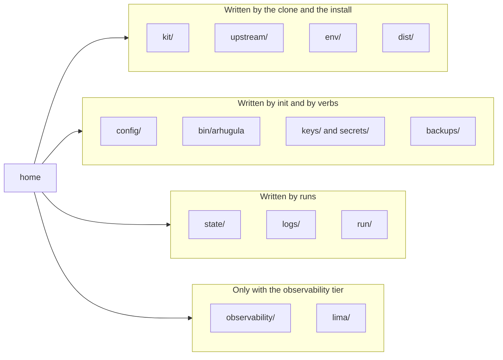
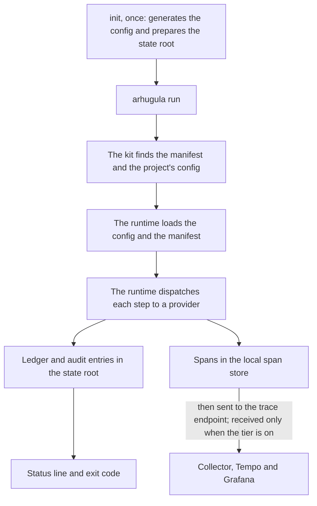

# Concepts: how a deployment works

This page is for operators and workflow authors who are new to the Arhugula Harness.
After reading it you can say where every part of a deployment lives, what happens during one run, and which provider serves a step.
It describes the kit at the upstream commit named in the file `PIN`.

To install a deployment, read [install](install.md). To look up a command, read the [command reference](reference/cli.md).

## Contents

- [The words these pages use](#the-words-these-pages-use)
- [The home holds the whole deployment](#the-home-holds-the-whole-deployment)
- [One install serves many projects](#one-install-serves-many-projects)
- [A workflow is a manifest, a topology and steps](#a-workflow-is-a-manifest-a-topology-and-steps)
- [One rule decides which provider serves a step](#one-rule-decides-which-provider-serves-a-step)
- [What happens during one run](#what-happens-during-one-run)
- [The state root keeps ledgers, memory and pauses](#the-state-root-keeps-ledgers-memory-and-pauses)
- [Gates stop a run until you answer](#gates-stop-a-run-until-you-answer)
- [Memory carries knowledge between runs](#memory-carries-knowledge-between-runs)
- [Where traces go](#where-traces-go)
- [Sources](#sources)

## The words these pages use

| Word | Meaning |
| --- | --- |
| harness, runtime | The upstream program that runs workflows. The kit installs it and never changes it. |
| kit | This repository: `init`, the `arhugula` command and these pages. |
| home | The one directory that holds a deployment. These pages write it as `<home>`. |
| project | A repository of yours that you attach to the deployment. These pages write its name as `<project>` and its directory as `<project-path>`. |
| manifest | A TOML file that describes one workflow. |
| provider | A model service that answers a step, such as Claude Code or Ollama. |
| verb | A subcommand of `arhugula`, such as `run` or `status`. |

Three markers in italics say how far to trust a statement.
*Witnessed* means it ran on the kit's development machine and the output was kept.
*Kit extension* means the kit adds it to the upstream harness.
*Upstream limit* means it does not exist, or does not work, at the pinned upstream commit.

## The home holds the whole deployment

A deployment is one plain directory, the home. The default is `~/arhugula`.
The kit finds its home as the directory that contains the kit clone, so it stores no path to find it.
The generated files and the Python environment do carry the home's path.
So move the home with `arhugula relocate`, which moves the directory and then rebuilds both.

The diagram groups the directories of the home by who writes them. The table after it gives the same facts in words.



| Path under `<home>` | What it holds | What writes it |
| --- | --- | --- |
| `kit/` | This repository. | You, with `git clone`. Init clones it there when you run init from a clone in another place. |
| `upstream/` | The harness source at the pinned commit. | The install. |
| `env/` | The private Python environment of the harness. A reinstall or an upgrade keeps the earlier one beside it as `env.rollback/`. | The install. |
| `dist/` | The seven built packages and two lock files with hashes. | The install. |
| `config/` | `init-answers.json`, and the `*.toml` files generated from it. | Init and the verbs. |
| `bin/arhugula` | The command, as a link into `kit/`. | Init. |
| `keys/`, `secrets/` | Signing keys, and the Grafana password. | Init or `arhugula audit keygen`, and the observability setup. |
| `backups/` | Archives of the state root. | `arhugula state backup`. |
| `state/` | The state root: ledgers, memory, pause journals and the local span store. | The runtime. |
| `logs/` | Install logs and one log per run. | The install and `arhugula run`. |
| `run/` | Process id files. | The runtime. |
| `observability/` | The Compose project of the trace stack. | `arhugula observability up`. |
| `lima/` | The kit's own virtual machine (VM). | `arhugula observability vm create`. |
| `AGENTS.md`, `CLAUDE.md` | Two short files that send an agent CLI to `kit/AGENTS.md`. | Init. |

The layout sets these rules:

- **One source of configuration:** `config/init-answers.json` holds your answers. Every `*.toml` file is generated from it, so you change a setting with a verb and never by editing a file.
- **Nothing to edit under the install:** an install or an upgrade checks out `upstream/` at the pinned commit and replaces `env/` whole. The install refuses an `upstream/` whose tracked files you changed.
- **Keys never leave:** `keys/` and `secrets/` are never in git and never in a backup. API keys are not in the home at all: they live in the macOS keychain.
- **Two caches stay outside:** uv and Lima keep their download caches in their own directories, outside the home.

## One install serves many projects

You install the harness once. Then you attach each repository that you want to run workflows in:

```sh
arhugula project add <project-path>
```

The harness is not copied into the project. Each attached project gets its own generated config, its own state and its own tenant id, which is the project name:

| What | Where |
| --- | --- |
| The project's manifests | `<project-path>/workflows/` |
| Working files of the harness | `<project-path>/.harness/` and `<project-path>/.agents/skills/` |
| The project's config | `<home>/config/projects/<project>.toml` |
| The project's ledger and memory | `<home>/state/projects/<project>/` |

One project is the *current project*. Most verbs act on it unless you pass `--project <project>`.
The `prompt` verbs, `validator list`, `bind` and `unbind`, and `config set` and `unset` act on every config of the deployment instead: see [Choose where a change applies](prompts-skills-validators.md#choose-where-a-change-applies).
When no project is current, or when you pass `--project default`, a verb acts on the *deployment default*.
The deployment default uses `<home>/config/harness.toml`, keeps its state directly in `<home>/state`, and runs in `<home>/upstream`.

This command lists the attached projects and marks the current one with `*`:

<!-- witness -->
```sh
arhugula project list
```

With one project attached under the name `demo`, it prints:

```text
   name  path            workload classes
*  demo  <project-path>  pipeline-automation,software-engineering,research,content-creation
```

Details: [projects](projects.md).

## A workflow is a manifest, a topology and steps

A manifest is one TOML file. It names the workflow, picks a topology, and lists the steps:

- **The workflow table:** `workflow_id` names the workflow. `workload_class` is one of four classes of work: `pipeline-automation`, `software-engineering`, `research` or `content-creation`.
- **The topology:** `topology_pattern` says how the steps relate. Six topologies ship, and [workflows](workflows.md) describes each one.
- **The steps:** each `[[steps]]` entry has a `step_id`, a `step_kind` and a payload. An `inference-step` calls a model. A `tool-step` calls one named tool, and no model decides. On `ollama` and `anthropic`, the model of an inference step can also call tools: see [Give agents tools](workflows.md#give-agents-tools).
- **The gates:** `hitl_placements` puts an approval gate in front of the tool steps it names. It does not cover a tool call that a model decides on.

A project can only run a workload class that it binds. Init binds all four by default.

Each agent step is one short, isolated provider call.
The call continues no earlier session.
When the provider is a command-line program, the runtime removes the provider API keys from the program's environment.
For Claude Code and Codex it also switches the program's own tools off.

One process runs the whole workflow. Where a topology has parallel branches, their agents run concurrently inside that process.

An agent inside a workflow never sees a `CLAUDE.md` or `AGENTS.md` file.
It sees the messages in the manifest, the versioned prompts, the skills and the memory packet.

Details: [workflows](workflows.md) and [authoring](authoring.md).

## One rule decides which provider serves a step

The routing rule: the config's first fallback chain serves every step; `--provider` (and `--model`) override it for one run; a manifest's own model binding does not select the provider.
A more specific setting wins over the chain: a per-step `model_binding` in a manifest, a workload override or a role binding.
See [How routing picks a provider](providers.md#how-routing-picks-a-provider).

A fallback chain is a default provider with its model, and the fallback provider that takes over when the default fails.
You choose both at init, at questions 3 and 4.
A manifest also carries a `[default_model_binding]` table, but the runtime treats it as a description.
So an example written for Ollama runs on your default provider unless you pass `--provider ollama`.

This command shows the chain:

<!-- witness -->
```sh
arhugula routing show
```

On a deployment with Claude Code as the default provider and Ollama as the fallback, it prints:

```text
The first fallback chain serves every step unless a run passes --provider.
  default:        claude_code/sonnet
  fallback:       ollama/llama3.2:3b  (cross family)

per-role bindings:
per-workload overrides:
retry policies:

embedding routing: off
```

An override does not switch the fallback off.
A run with `--provider` prints one `override:` line, and the chain still applies if that provider fails.

Details: [providers](providers.md).

## What happens during one run

The diagram follows one run from the command to its records. The numbered list after it says the same in words.



1. **Init, once.** Init generates the config, has the runtime's own loader accept it, and has the runtime stamp the state root.
2. **You run a workflow.** `arhugula run <manifest>` looks for the manifest in this order: the path as you typed it, the project, its `workflows/` directory, the upstream source, and upstream's `examples/`.
3. **The kit starts the runtime.** It starts the runtime in the project's directory, with the project's generated config. It copies the run's progress messages to a log under `<home>/logs/`.
4. **The runtime loads.** It loads the config, then the manifest, then applies `--provider` and `--model`. A config or a manifest that does not load stops the run here.
5. **Each step is dispatched.** The routing rule picks the provider. When memory is on, the runtime adds the memory packet to the prompt. A gated tool call waits for your answer.
6. **The run is recorded.** The runtime appends entries to the project's ledger, and each entry carries the hash of the one before it.
7. **Spans are stored.** The runtime writes the run's spans to the local span store first, then sends them to the trace endpoint.
8. **The run ends.** It prints a status line and exits with a code. `status: completed` comes with exit code 0.

This is a complete run on Ollama, pasted from a real run (*witnessed*), with the provider's log lines trimmed:

```text
override:  every step dispatches first to ollama/llama3.2:3b; the config's fallback chain applies if that candidate fails
...
status:    completed
workflow:  example-ollama-first
ledger:    1736ee1536a512c4e35391512d32583d2110311ddc30511bb2fed31378eeb0a1
```

That run added three entries to the ledger: a cost entry, an audit entry and an entry for the step.
A call through a signed-in command-line provider is never priced, so it writes no cost entry (*upstream limit*, by design).
A run on Claude Code wrote its step entries to the ledger, and no cost entry and no audit entry (*witnessed*; upstream issue #1743 covers both missing entries).
The `ledger:` line prints the hash of the newest audit entry, so that run left it unchanged, while `arhugula status` showed the new head of the ledger.

Details: [operate](operate.md).

## The state root keeps ledgers, memory and pauses

The state root is `<home>/state`. Everything that a run must not lose lives there, and nothing of it lives in your project.

| In the state root | What it is |
| --- | --- |
| `state-ledger/state.jsonl` | The ledger: one entry per recorded action. Each entry carries a hash that chains it to the entry before. |
| `state-ledger/audit-entries.jsonl` | The audit entries of the same ledger. |
| `memory/` | The memory that belongs with that ledger. |
| `pause-journal/` | The record of paused runs, for the whole deployment. |
| `observability/spans.sqlite` | The local span store, for the whole deployment. |

The ledger and the memory directly in the state root belong to the deployment default.
Each attached project has its own ledger and memory under `<home>/state/projects/<project>/`.

The runtime guards the state root:

- **It stamps the root:** the runtime marks a state root that it accepted, and it refuses a root that holds files it did not stamp.
- **It refuses risky places:** it refuses a state root inside a git checkout, and inside a backup location that could restore over it. Init asks for those locations at question 13.
- **Every ledger has a hash chain:** `arhugula audit verify` checks the chain of a ledger. For a ledger signed from its first entry, it also checks every signature.
- **Signatures are optional:** with audit signing on, each audit entry is also signed with a local key. A ledger that began unsigned keeps hash-chain verification only (*upstream limit*). Authoring a cutover record over it afterwards was tried, and verification then fails with `signature-invalid` (*witnessed*).

This command shows the state root, its size and each project's ledger. It changes nothing:

<!-- witness -->
```sh
arhugula state status
```

Details: [operate](operate.md) and [security and isolation](security-and-isolation.md).

## Gates stop a run until you answer

A gate is a stop in front of a tool call. A person must decide before the call happens.
For a tool step, a manifest places the gate, and the policy decides whether the gate asks you or approves on its own.
For a tool call that a model decides on, no placement applies: the persona, the server's declared labels and the policy decide.
`arhugula policy show` prints the policy, and [Set what a gate approves without asking](security-and-isolation.md#set-what-a-gate-approves-without-asking) explains both cases.

When a gate asks, it prints the step and its payload, then this prompt:

```text
answer (approve | edit | reject | respond | hold | cancel):
```

| Answer | What happens |
| --- | --- |
| `approve` | The step runs once. |
| `edit` | The step runs once with the payload you give. |
| `reject` | The step does not run. |
| `respond` | Your text goes to the gate. |
| `hold` | The run pauses, and you answer later with `arhugula gate approve` or `arhugula gate deny`. |
| `cancel` | The gate ends, and the step does not run. |

Know these facts before you use gates:

- **Hold needs two settings:** durable pause (`arhugula pause enable`) and a notification address (`arhugula webhook set <url>`).
- **A held run exits with code 5:** it prints `status: paused`. That is the runtime's own code for a run on hold, not a failure.
- **A gate needs a terminal:** a run without a terminal rejects its gate (*upstream limit*).

Gates belong to you. An agent CLI that operates the deployment must not answer one: see [AGENTS.md](../AGENTS.md).

Details: [operate](operate.md) and [workflows](workflows.md).

## Memory carries knowledge between runs

Memory is on by default, and each project has its own under `<home>/state/projects/<project>/memory`.

- **What goes in:** the runtime captures what happened in a run.
- **What comes out:** a later run receives a small, read-only memory packet in its prompt. With the mode `packet+tools`, the agent can also call memory tools.
- **What you decide:** a captured item becomes reusable knowledge only when you approve it, with `arhugula memory review`. Each proposal is decided at most once.

Details: [memory](memory.md).

## Where traces go

A trace is the timed record of one run, and it is made of spans.

| Where | When | How you read it |
| --- | --- | --- |
| The local span store, `<home>/state/observability/spans.sqlite` | On every run. | `arhugula trace list`, `arhugula trace browse`, `arhugula trace export` |
| The trace endpoint, `127.0.0.1:4317` | On every run, after the local store. | Only through the observability tier. |
| Tempo and Grafana, in the VM of the observability tier | Only when the observability tier is on. | Grafana at `http://127.0.0.1:3000` |

With the tier off, nothing listens at the trace endpoint.
The spans sent there are dropped.
Each run then prints a few retry lines from the exporter, which is the part of the runtime that sends spans.
The local span store, the ledgers and the audit entries still fill up.

With the tier on, the collector receives the spans and Tempo keeps them for 24 hours.
Every run appears under the service name `arhugula-harness`.

Two things are missing from spans: the finish reason of a model call, and a span per step (*upstream limit*).

Details: [observability](observability.md).

## Sources

This page was checked against these kit files:

- **Layout:** `lib/arhugula_kit/layout.py`, `lib/arhugula_kit/initflow.py`, `bin/install.sh`.
- **Projects and configs:** `lib/arhugula_kit/render.py`, `lib/arhugula_kit/deploy.py`, `lib/arhugula_kit/verbs_project.py`.
- **Runs and gates:** `lib/arhugula_kit/verbs_run.py`, `lib/arhugula_kit/common.py`, `lib/arhugula_kit/verbs_config.py`, `examples/workflows/gated-tool.toml`.
- **Agents:** `AGENTS.md`.

It was checked against these upstream documents, with paths relative to the home:

- **Runtime flow:** `upstream/docs/architecture.md`.
- **Runs, gates, pauses and the span store:** `upstream/docs/how-to-operate-runtime.md`.
- **Manifests:** `upstream/docs/reference.md`, `upstream/examples/ollama-first.toml`.
- **Memory:** `upstream/docs/memory-layer-readme.md`.
