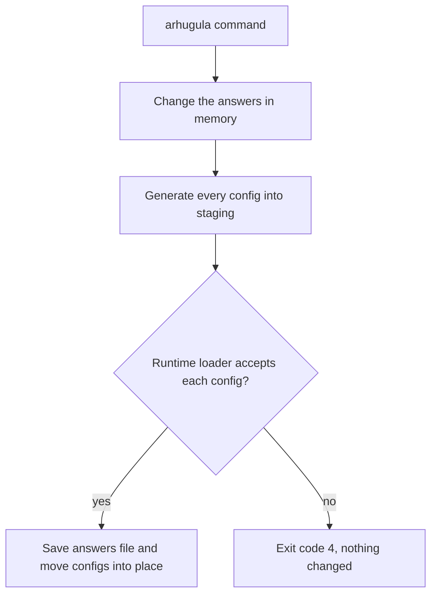

# Configure the runtime

This page is a reference for an operator or a workflow author who changes how the harness runtime behaves.
After reading it you can read a generated config, find the command or the named feature that sets any runtime key, and change a key that no command names.

It applies to the upstream commit named in the kit's `PIN` file; `arhugula --version` prints that commit.

Other pages cover the neighbouring tasks:

- **First configuration:** [Install](install.md) describes `init` and its questions.
- **Providers and routing:** [Providers](providers.md) describes each provider and the routing commands.
- **Every argument:** [the command reference](reference/cli.md) lists every command.

## On this page

- [How configuration changes](#how-configuration-changes)
- [Read a generated config](#read-a-generated-config)
- [Capability matrix](#capability-matrix)
- [Set a key that no command names](#set-a-key-that-no-command-names)
- [Switch named features on and off](#switch-named-features-on-and-off)
- [Every named feature](#every-named-feature)
- [Check the approval policy](#check-the-approval-policy)
- [Offline embedding routing](#offline-embedding-routing)
- [Keep secrets out of TOML](#keep-secrets-out-of-toml)
- [What `sampling_mode` does at this pin](#what-sampling_mode-does-at-this-pin)
- [Sources](#sources)

## How configuration changes

The answers file `<home>/config/init-answers.json` is the one source of the configuration.
The kit generates every config file the runtime reads from it (*kit extension*).
You never edit a generated file: the next command would overwrite your change.

| File | What it is |
| --- | --- |
| `<home>/config/init-answers.json` | The answers file: your `init` answers, the features that are on, and every setting a command stored |
| `<home>/config/harness.toml` | The generated config of the deployment default, used when no project is current |
| `<home>/config/projects/<project>.toml` | The generated config of one attached project |

Every `arhugula` command that changes configuration works in the same four steps:

1. The command changes the answers in memory.
2. The kit generates every config again, into a staging directory.
3. The runtime's own loader reads each staged config.
4. When the loader accepts them all, the kit saves the answers file and moves the configs into place.

When the loader refuses one config, the command ends with exit code 4 and the loader's reason.
Nothing was changed: the answers file and every config stay as they were.

A running daemon keeps the config it loaded when it started.
To have it use a change, restart the daemon of each project whose runs you send with `--daemon`.
Run `arhugula daemon stop`, then `arhugula daemon start`: see [Run workflows through the daemon](operate.md#run-workflows-through-the-daemon).



The diagram shows the same four steps, with the two ways the last check can end.

Run one configuration command at a time.
While one command changes the configuration, a second one stops with exit code 3 and this message:

```text
another `arhugula` command is changing this deployment's configuration
```

Wait for the first command to finish, then run the second one again.

### How a config is put together

The kit builds each config from four layers, in this order.
A later layer wins over an earlier one.

1. **The base:** what your `init` answers decide, such as providers, the fallback chain and the paths.
2. **The features:** the TOML of each named feature that is on.
3. **Deployment settings:** what commands stored for every config.
4. **Project settings:** what commands stored for one project with `--project <project>`.

Tables merge key by key.
Any other value, including a list, replaces the earlier value whole.

### Where the runtime reads values from

The runtime's loader takes values from three places.
A later place wins over an earlier one.

| Order | Place | What the kit does with it |
| --- | --- | --- |
| 1 | Environment variables that start with `HARNESS_` | The kit sets none. Your shell's variables pass through to the runtime. |
| 2 | The config file | The kit always passes the generated config of the project. |
| 3 | Options of the run | `arhugula run --provider` and `--model` change the routing of one run. |

The loader reads only a few keys from the environment.
They are `deployment_surface`, `repository_root`, `default_topology`, `tenant_id`, `ollama_host`, `ollama_optional`, `effect_fencing`, `routing_activation`, `prompt_cache_boot_prewarm`, `prompt_cache_keepalive`, `sub_agent_dispatch_max_workers`, `audit_signing_fail_closed` and `protected_result_store_ttl_seconds`.
A variable such as `HARNESS_EFFECT_FENCING` therefore takes effect only when the generated config does not set that key.
Prefer a command or a named feature: it is stored, checked by the loader and visible in `arhugula config show`.

## Read a generated config

Print the generated config of the current project, or of the project you name with `--project`:

<!-- witness -->
```sh
arhugula config show
```

This is the config of a project named `demo` on the development deployment, shortened where a line shows `...`.
The header names the answers file and repeats that no secret belongs in the file.

```toml
# Arhugula Harness runtime config: demo.
# GENERATED from <home>/config/init-answers.json. Do not edit: your change would be overwritten.
# Change it with an `arhugula` verb (`arhugula --help`), which edits the answers file
# and regenerates this file. No secret belongs here; keys live in the OS keyring.


[runtime]
deployment_surface = "local-development"
repository_root = "<project-path>"
default_topology = "single-threaded-linear"
enabled_provider_names = ["claude_code", "ollama", "codex", "antigravity"]
pidfile_path = "<home>/run/demo.pid"
tenant_id = "demo"
ollama_host = "http://127.0.0.1:11434"
ollama_optional = false
...

[runtime.memory]
enabled = true
standard_tools_enabled = true
root_path = "<home>/state/projects/demo/memory"

[runtime.otel]
otlp_endpoint = "http://127.0.0.1:4317"
additional_resource_attrs = [["service.name", "arhugula-harness"], ["service.namespace", "demo"]]

[runtime.collector]
span_store_path = "<home>/state/observability/spans.sqlite"

[runtime.state_placement]
state_root = "<home>/state"
forbidden_roots = []

[runtime.path_bindings]

[[runtime.path_bindings.raw_entries]]
path_class = "SKILLS"
workflow_class = "pipeline-automation"
deployment_surface = "local-development"
path = "<project-path>/.agents/skills"
...

[runtime.routing_manifest]
manifest_version = 1
per_role_bindings = {}
per_workload_overrides = {}
retry_policies = {}

[[runtime.routing_manifest.fallback_chains]]
same_family = []

[runtime.routing_manifest.fallback_chains.primary]
provider = "claude_code"
model = "sonnet"
family = "anthropic"

[[runtime.routing_manifest.fallback_chains.cross_family]]
provider = "ollama"
model = "llama3.2:3b"
family = "local_open_weight"

[runtime.hitl_auto_approve_policy]
solo_persona_floor_auto = true
...

[[runtime.external_cli_providers]]
provider = "claude_code"
kind = "claude-code"
command = "<path-to>/claude"
timeout_seconds = 120
auth_check = true
optional = false
...
```

Every key sits under `[runtime]`.
This table explains each part of the file, from top to bottom.

| Part of the file | What it holds | Where it comes from |
| --- | --- | --- |
| The first keys of `[runtime]` | The deployment kind, the project's repository, the enabled providers, the project name as `tenant_id` and the Ollama address | The base, from your `init` answers and `arhugula project add` |
| `[runtime.memory]` | Whether memory is on, its mode and where the project's memory lives | The feature `memory` and the memory mode you chose at `init` |
| `[runtime.otel]` | The loopback address that traces go to, and the service name and project name on each trace | The base |
| `[runtime.collector]` | The file of the local span store | The base |
| `[runtime.state_placement]` | The state root, and directories the state must never be in | The base |
| `[[runtime.path_bindings.raw_entries]]` | One entry for each workload class and each kind of path: skills, prompts, routing manifest, state ledger | The base, from the project's workload classes |
| `[runtime.routing_manifest]` | The fallback chain with the default and the fallback provider, then role bindings, workload overrides and retry policies | The base and the `arhugula routing` commands |
| `[runtime.hitl_auto_approve_policy]` | What an approval gate approves without asking | `arhugula policy set` |
| `[[runtime.external_cli_providers]]` | One entry for each command-line provider: its program, time limit and sign-in check | The base and `arhugula provider set` |

The routing rule: the config's first fallback chain serves every step; `--provider` (and `--model`) override it for one run; a manifest's own model binding does not select the provider.
One manifest setting is the exception: a `model_binding` in `per_step_overrides` sends its step to the provider it names. See [How routing picks a provider](providers.md#how-routing-picks-a-provider).
To choose a model and a thinking level for one step, role, workload class, the default or one run, see [Choose a model and a thinking level](providers.md#choose-a-model-and-a-thinking-level).

A config can hold more parts than this table lists, for example prompt versions, validator bindings and clients for Model Context Protocol (MCP) tool servers.
The [capability matrix](#capability-matrix) names the command behind each.

To see only what commands stored, without the base and the features, add `--overlay`:

<!-- witness -->
```sh
arhugula config show --overlay
```

The output is JSON in the shape of the TOML.
Without `--project` it holds the settings stored for every config.
With `--project <project>` it holds the settings stored for that project only.
A path in it can show a placeholder such as `{{HOME}}`, which the kit replaces when it generates the configs.

## Capability matrix

The runtime at this pin has 53 keys under `[runtime]`.
Each table below covers one area: the key, what it means, and the command or named feature that sets it.
`arhugula feature list` is the authority for feature names, and `arhugula config keys` for key names.

Three phrases recur in the last column:

- **Feature `name`:** switch it on with `arhugula feature enable <name>`.
- **Fixed by the kit:** the kit derives the value; you do not set it.
- **`config set`:** no command names the key, so use `arhugula config set <key> <value>`.

### Deployment and placement

| Key | What it means | Set it with |
| --- | --- | --- |
| `deployment_surface` | The kind of deployment, always `local-development` here. | Fixed by the kit |
| `repository_root` | The repository the runtime works in: the project's, or the upstream checkout for the deployment default. | `arhugula project add` |
| `tenant_id` | The name that separates one project's records from another's: the project name. | `arhugula project add` |
| `path_bindings` | Where skills, prompts, the routing manifest and the state ledger live for each workload class. | `arhugula project add`; worktree options with feature `worktree-isolation` |
| `state_placement` | The state root, and directories that must never hold state. | The home decides the state root (`arhugula relocate`); `init` question 13 sets the other directories (`arhugula init --reconfigure`) |
| `persona_tier` | Whether the deployment counts as one developer or a team. It decides trace sampling, trace redaction and whether a prompt version needs approval. An approval gate reads the `persona_tier` of the workflow's manifest instead: see [workflows](workflows.md#read-a-manifest-field-by-field). | Feature `persona-team` |
| `default_topology` | The topology used when a workflow names none. | Fixed by the kit as `single-threaded-linear`; `config set` |
| `pidfile_path` | The file that records the running runtime's process id. | Fixed by the kit under `<home>/run` |

### Providers

| Key | What it means | Set it with |
| --- | --- | --- |
| `enabled_provider_names` | The providers the runtime may use. | `arhugula provider enable`, `arhugula provider disable` |
| `external_cli_providers` | One entry for each command-line provider: its program, time limit and sign-in check. | `arhugula provider enable --command`, `arhugula provider set`, `arhugula provider unset` |
| `ollama_host` | The address of the Ollama server. | `arhugula provider ollama-host <url>`; `init` question 6, which `arhugula init --reconfigure` asks only while Ollama does not answer at its address |
| `ollama_optional`, `anthropic_optional`, `openai_optional` | Whether the runtime may start when that provider does not answer. | Fixed by the kit: false for the default and the fallback provider (`arhugula routing chain set`) |
| `provider_secrets` | The keyring service and the names of the secrets the runtime may read. It never holds a secret value. | `config set` |

### Routing

| Key | What it means | Set it with |
| --- | --- | --- |
| `routing_manifest` | The fallback chain, role bindings, workload overrides and retry policies. | `arhugula routing chain set`, `routing model set`, `routing role bind`, `routing workload override`, `routing retry set` |
| `routing_activation` | Whether routing may fall through to the local embedding classifier. | Feature `embedding-routing` |
| `embedding_model_dir`, `embedding_cache_dir` | Where the embedding model and its cache are. | Feature `embedding-routing` |
| `embedding_routing_candidates` | The provider and model the classifier picks for each workload class. | Feature `embedding-routing`; `config set` for one class |

### Execution

| Key | What it means | Set it with |
| --- | --- | --- |
| `inter_step_data_flow` | Each step receives the most recently recorded step output. | Feature `data-flow` |
| `engine_output_replay` | A resumed run gets back the outputs of steps that already ran. | Feature `engine-replay` |
| `effect_fencing` | A tool step that is not safe to repeat runs at most once across retries and resumes. | Feature `effect-fencing` |
| `step_dispatch_timeout_seconds` | How long one whole step may take, with a wait at an approval gate included; 30 seconds unless set. A provider's own `timeout_seconds` bounds one call inside the step: see [providers](providers.md#enable-disable-and-tune-a-provider). | Feature `deadlines`; `config set` |
| `drain_timeout_seconds` | How long a whole workflow run may take, all steps together; 60 seconds unless set. After that the runtime stops waiting and ends the run with status `drained` and `RT-FAIL-DRAIN-TIMEOUT`. It does not cancel the step in flight. | Feature `deadlines`; `config set` |
| `sub_agent_dispatch_max_workers` | How many sub-agent calls may run at once; 256 unless set. | Feature `concurrency`; `config set` |

### Gates, tools and validators

| Key | What it means | Set it with |
| --- | --- | --- |
| `hitl_auto_approve_policy` | What an approval gate approves without asking. | `arhugula policy set` |
| `mcp_clients` | The MCP tool servers, each with its trust level, blast radius and optional sandbox. | `arhugula mcp add`, `arhugula mcp remove`; the sandbox with `arhugula isolation enable` and `isolation attach` |
| `trust_policy` | The trust rule for MCP servers that you do not list. | Feature `trust-policy`; `config set` for its lists |
| `sandbox_decision_policy` | The sandbox decision policy. The table has no fields at this pin. | Feature `sandbox-policy` |
| `validator_framework_config` | The validators bound to step ids. | `arhugula validator bind`, `arhugula validator unbind` |
| `pause_resume_protocol_config` | Whether a paused run is written to a journal so it can continue later. | `arhugula pause enable`, `arhugula pause disable` (feature `durable-pause`) |
| `webhook_delivery_composer_config` | The address that receives a notification when a run pauses. | `arhugula webhook set`, `arhugula webhook clear` |

Add a `stdio` tool server with `arhugula mcp add <name> --transport stdio` and the server's command in `--url`.
Its tools run only at isolation tier 3, which needs the virtual machine: see [Give your own MCP client a sandbox](security-and-isolation.md#give-your-own-mcp-client-a-sandbox).
A `stdio` client and an HTTP client do not work together: see [the troubleshooting entry](troubleshooting.md#cancellederror-cancelled-via-cancel-scope-stdio-and-http-mcp-clients-together).

### Prompts and skills

| Key | What it means | Set it with |
| --- | --- | --- |
| `prompt_manifest` | The authored prompt versions and the active one. | `arhugula prompt author`, `arhugula prompt activate` |
| `prompt_selection_manifest` | The prompt version for each workload class. | `arhugula prompt select` |
| `approved_prompt_version_shas` | The approved prompt versions. | `arhugula prompt approve` |
| `prompt_cache_long_ttl_workloads`, `prompt_cache_boot_prewarm`, `prompt_cache_prewarm_model` | The one-hour cache tier and the warm-up of the Anthropic API prompt cache. | Feature `prompt-cache` |
| `prompt_cache_keepalive` | A regular ping that keeps that cache warm while a daemon runs. | Feature `prompt-cache-keepalive` |
| `skill_activation_hook_config` | The hook that decides which skills a run activates. *Upstream limit:* a TOML file cannot carry it. | `arhugula skill hook set` (*kit extension*) |

[Manage prompts, skills and validators](prompts-skills-validators.md) describes these commands.

### Memory

| Key | What it means | Set it with |
| --- | --- | --- |
| `memory` | Whether memory is on, where it lives, and whether agents get memory tools as well as the memory packet. | Feature `memory`; the mode with `init` question 10; features `memory-native` and `memory-procedural`; `config set` for other fields |
| `memory_tool_backend_config` | How the memory tool stores its files. | Feature `memory-encrypted` |

[Memory](memory.md) describes the memory commands.

### Observability

| Key | What it means | Set it with |
| --- | --- | --- |
| `otel` | Where traces go, and the service name on each trace. Its field `sampling_mode` changes nothing at this pin. | Fixed by the kit; feature `tail-sampling` sets `sampling_mode` |
| `collector` | The local span store: its file, how long it keeps spans, and its batch sizes. | Fixed by the kit; feature `collector-tuning` |

[Observability](observability.md) describes the trace stack.

### Audit

| Key | What it means | Set it with |
| --- | --- | --- |
| `audit_signing` | Whether audit entries are signed, and with which key files. | `arhugula audit keygen`, then `arhugula audit enable` (feature `audit-signing`); `init` generates the keys itself when you choose the feature at question 9 |
| `audit_cutover_record_key_id`, `audit_cutover_record_path`, `audit_ledger_binding_id` | The record that marks a ledger as signed from its first entry. | Fixed by the kit for each ledger that was empty when signing went on |
| `audit_signing_fail_closed` | A step fails when its audit entry cannot be signed. | Feature `audit-fail-closed` |
| `protected_result_store_key_env_var` | The name of the environment variable that holds the key of the encrypted result store. | `config set` |
| `protected_result_store_ttl_seconds` | How long that store keeps an entry nobody collected; 86400 seconds unless set. | `config set` |

[Security and isolation](security-and-isolation.md) describes signing and verification.

### Managed agents

| Key | What it means | Set it with |
| --- | --- | --- |
| `managed_agents_config` | The settings for upstream's managed-agents carrier. *Upstream limit:* upstream binds it only on a managed-cloud deployment, so it has no effect here. | Feature `managed-agents` |

## Set a key that no command names

Four commands reach every key, including those no other command names.

| Command | What it does |
| --- | --- |
| `arhugula config keys` | Lists every key the runtime has at the installed pin. |
| `arhugula config show` | Prints a generated config. With `--overlay` it prints only the stored settings. |
| `arhugula config set <key> <value>` | Stores a value for a key under `[runtime]`. |
| `arhugula config unset <key>` | Removes a stored value, so the key returns to its generated or default value. |

List the keys:

<!-- witness -->
```sh
arhugula config keys
```

```text
anthropic_optional
approved_prompt_version_shas
audit_cutover_record_key_id
...
validator_framework_config
webhook_delivery_composer_config

Each is a key under [runtime]; docs/configure.md says what each one does.
```

Follow these rules when you set a key:

- **Write the value as TOML:** `120`, `true`, `"text"` or `["a", "b"]`. Quote the whole value for your shell when it holds quotes or brackets.
- **Use dots for a nested key:** `memory.token_budget` is the key `token_budget` in the table `[runtime.memory]`.
- **Choose the scope:** without `--project` the value goes into every config; with `--project <project>` into that project's config only.
- **Expect the loader's check:** when the runtime refuses the value, the command ends with exit code 4 and nothing changes.

Set how long the runtime waits for a whole run, then remove the setting again:

<!-- witness -->
```sh
arhugula config set drain_timeout_seconds 90
arhugula config unset drain_timeout_seconds
```

A value you store wins over a named feature that sets the same key, because stored settings are the later layer.

## Switch named features on and off

A named feature is a small piece of TOML that the kit merges into every generated config (*kit extension*).
Each feature has a name, a description and a statement of what it needs.

| Command | What it does |
| --- | --- |
| `arhugula feature list` | Lists every feature, whether it is on, and what it needs. |
| `arhugula feature show <name>` | Shows what a feature does and the exact TOML it merges. |
| `arhugula feature enable <name>` | Switches a feature on in every generated config. |
| `arhugula feature disable <name>` | Switches a feature off. |

List the features:

<!-- witness -->
```sh
arhugula feature list
```

This is the list on the development deployment, where only `memory` is on:

```text
state  feature                 what it is                                 needs
off    audit-fail-closed       Fail-closed audit signing                  audit signing, and the environment variable HARNESS_PROTECTED_RESULT_STORE_KEY holding a base64 Fernet key
off    audit-signing           Audit signing                              the two keys: arhugula audit keygen
off    collector-tuning        Span store tuning                          nothing
off    concurrency             Bounded sub-agent concurrency              nothing
off    data-flow               Inter-step data flow                       nothing
off    deadlines               Longer deadlines                           nothing
off    durable-pause           Durable pause and resume                   to answer `hold` at a gate, also a notification endpoint: arhugula webhook set <url>
off    effect-fencing          Effect fencing                             nothing
off    embedding-routing       Offline embedding routing                  the embedding model at <home>/models/bge-small-en-v1.5 with its SHA256SUMS (docs/configure.md, "Offline embedding routing")
off    engine-replay           Engine output replay                       nothing
off    managed-agents          Managed agents                             a managed-cloud deployment (an upstream limit for this kit)
on     memory                  Memory                                     nothing
off    memory-encrypted        Encrypted memory tool storage              memory enabled
off    memory-native           Provider-native memory                     memory enabled, and a provider that offers a memory API (the Anthropic API provider)
off    memory-procedural       Procedural memory proposals                memory enabled
off    persona-team            Team persona                               nothing
off    prompt-cache            Anthropic prompt cache tuning              the Anthropic API provider: arhugula provider enable anthropic, then arhugula provider key set anthropic
off    prompt-cache-keepalive  Anthropic prompt cache keep-alive          the Anthropic API provider and a running daemon
off    sandbox-policy          Explicit sandbox decision policy           nothing
off    tail-sampling           Tail-based trace sampling                  nothing
off    trust-policy            Explicit MCP trust policy                  nothing
off    worktree-isolation      Worktree isolation and shadow checkpoints  the project is a git repository

details: arhugula feature show <feature>
```

Look at one feature before you switch it on:

<!-- witness -->
```sh
arhugula feature show deadlines
```

```text
deadlines: Longer deadlines
state:  off
needs:  nothing

Raises the per-step dispatch deadline from 30 to 120 seconds and the drain deadline from 60 to 120 seconds, for slow local models. Set other values with `arhugula config set step_dispatch_timeout_seconds <seconds>`.

It merges this into every generated config:

[runtime]
step_dispatch_timeout_seconds = 120.0
drain_timeout_seconds = 120.0
```

Switch it on, and off again when you no longer want it:

```sh
arhugula feature enable deadlines
arhugula feature disable deadlines
```

A feature applies to every config of the deployment; it takes no `--project`.
Some features have their own command that also checks what the feature needs: `arhugula pause enable` for `durable-pause`, and `arhugula audit enable` for `audit-signing`.
Five features are also offered by `init` question 9: `memory`, `durable-pause`, `data-flow`, `audit-signing` and `embedding-routing`.

## Every named feature

The list below is generated from the kit's `fragments/` directory.
It shows each feature with the exact TOML it merges.

<!-- BEGIN GENERATED: fragments -->
### `audit-fail-closed`: Fail-closed audit signing

A step whose audit entry cannot be signed fails instead of proceeding. Its result is held in an encrypted store until the entry is written.

Needs: audit signing, and the environment variable HARNESS_PROTECTED_RESULT_STORE_KEY holding a base64 Fernet key

Switch it on with `arhugula feature enable audit-fail-closed`. It adds:

```toml
[runtime]
audit_signing_fail_closed = true
```

### `audit-signing`: Audit signing

Every audit entry is signed with a local Ed25519 key. A ledger that is signed from its first entry also gets a cutover record, and then verifies in full with `arhugula audit verify --signatures`.

Needs: the two keys: arhugula audit keygen

Switch it on with `arhugula feature enable audit-signing`. It adds:

```toml
[runtime.audit_signing]
backend = "local-ed25519"

[runtime.audit_signing.local_key_paths]
"harness-runtime-dev" = "{{KEYS}}/audit-ed25519.pem"
"harness-cost-attribution-v1" = "{{KEYS}}/audit-ed25519.pem"
```

### `collector-tuning`: Span store tuning

Keeps spans in the local span store for 30 days instead of 7 and exports in smaller, more frequent batches.

Needs: nothing

Switch it on with `arhugula feature enable collector-tuning`. It adds:

```toml
[runtime.collector]
sqlite_retention_days = 30
batch_window_seconds = 2
batch_size = 128
```

### `concurrency`: Bounded sub-agent concurrency

Lowers the shared sub-agent dispatch budget from 256 to 16 frames, which keeps a parallel or hierarchical workflow from overloading a local model server. At the cap, admission fails at once; it never queues.

Needs: nothing

Switch it on with `arhugula feature enable concurrency`. It adds:

```toml
[runtime]
sub_agent_dispatch_max_workers = 16
```

### `data-flow`: Inter-step data flow

Each step receives the most recently recorded step output. Handoff and evaluator-optimizer workflows need it; peer branches of a parallel workflow are not meant to consume it.

Needs: nothing

Switch it on with `arhugula feature enable data-flow`. It adds:

```toml
[runtime]
inter_step_data_flow = true
```

### `deadlines`: Longer deadlines

Raises the per-step dispatch deadline from 30 to 120 seconds and the drain deadline from 60 to 120 seconds, for slow local models. Set other values with `arhugula config set step_dispatch_timeout_seconds <seconds>`.

Needs: nothing

Switch it on with `arhugula feature enable deadlines`. It adds:

```toml
[runtime]
step_dispatch_timeout_seconds = 120.0
drain_timeout_seconds = 120.0
```

### `durable-pause`: Durable pause and resume

A run that pauses at a gate is journalled, so `arhugula resume` can continue it after the process has exited.

Needs: to answer `hold` at a gate, also a notification endpoint: arhugula webhook set <url>

Switch it on with `arhugula feature enable durable-pause`. It adds:

```toml
[runtime.pause_resume_protocol_config]
durable = true
```

### `effect-fencing`: Effect fencing

A tool step that is not idempotent runs at most once across retries and resumes of a durable engine.

Needs: nothing

Switch it on with `arhugula feature enable effect-fencing`. It adds:

```toml
[runtime]
effect_fencing = true
```

### `embedding-routing`: Offline embedding routing

Routing may fall through from the declared bindings to a local embedding classifier, which picks among the candidates below with no network access.

Needs: the embedding model at <home>/models/bge-small-en-v1.5 with its SHA256SUMS (docs/configure.md, "Offline embedding routing")

Switch it on with `arhugula feature enable embedding-routing`. It adds:

```toml
[runtime]
routing_activation = true
embedding_model_dir = "{{HOME}}/models/bge-small-en-v1.5"
embedding_cache_dir = "{{HOME}}/embedding-cache"

[runtime.embedding_routing_candidates]
"software-engineering" = "{{PRIMARY_LABEL}}"
"content-creation" = "{{PRIMARY_LABEL}}"
"pipeline-automation" = "{{PRIMARY_LABEL}}"
"research" = "{{PRIMARY_LABEL}}"
```

### `engine-replay`: Engine output replay

Step outputs are kept in a durable event history, so a resumed run rehydrates the outputs of steps that already ran instead of losing them.

Needs: nothing

Switch it on with `arhugula feature enable engine-replay`. It adds:

```toml
[runtime]
engine_output_replay = true
```

### `managed-agents`: Managed agents

Declares the managed-agents dispatch carrier. Upstream binds it only on the managed-cloud deployment surface with a client supplied from Python, so on this local deployment it has no effect.

Needs: a managed-cloud deployment (an upstream limit for this kit)

Switch it on with `arhugula feature enable managed-agents`. It adds:

```toml
[runtime.managed_agents_config]
step_timeout_seconds = 600.0
```

### `memory-encrypted`: Encrypted memory tool storage

The Memory tool stores its files encrypted at rest instead of as plain files.

Needs: memory enabled

Switch it on with `arhugula feature enable memory-encrypted`. It adds:

```toml
[runtime.memory_tool_backend_config]
backend = "encrypted_filesystem"
```

### `memory-native`: Provider-native memory

Allows a provider's own remote memory API in addition to the local memory packet and tools. Memory then also lives with that provider.

Needs: memory enabled, and a provider that offers a memory API (the Anthropic API provider)

Switch it on with `arhugula feature enable memory-native`. It adds:

```toml
[runtime.memory]
native_provider_enabled = true
```

### `memory-procedural`: Procedural memory proposals

Reviewed memory proposals target procedural memory (how to do things) instead of semantic memory (facts and decisions).

Needs: memory enabled

Switch it on with `arhugula feature enable memory-procedural`. It adds:

```toml
[runtime.memory]
promotion_decision = "propose_procedural"
```

### `memory`: Memory

The harness captures run events and turns, and adds a memory packet to each prompt. Promotion to long-term memory waits for your review (`arhugula memory review`).

Needs: nothing

Switch it on with `arhugula feature enable memory`. It adds:

```toml
[runtime.memory]
enabled = true
root_path = "{{TARGET_STATE}}/memory"
```

### `persona-team`: Team persona

Classifies the deployment as `team-binding` instead of `solo-developer`. The persona drives the trace sampling base rate, redaction, and whether a prompt version needs approval.

Needs: nothing

Switch it on with `arhugula feature enable persona-team`. It adds:

```toml
[runtime]
persona_tier = "team-binding"
```

### `prompt-cache-keepalive`: Anthropic prompt cache keep-alive

While a daemon runs, a ping every 240 seconds keeps the Anthropic prompt cache warm. It affects only the Anthropic API provider and only the daemon.

Needs: the Anthropic API provider and a running daemon

Switch it on with `arhugula feature enable prompt-cache-keepalive`. It adds:

```toml
[runtime]
prompt_cache_keepalive = true
prompt_cache_prewarm_model = "claude-haiku-4-5"
```

### `prompt-cache`: Anthropic prompt cache tuning

Uses the one-hour prompt cache tier for the research workload and pre-warms the cache at start. It affects only the Anthropic API provider; subscription CLIs manage their own cache.

Needs: the Anthropic API provider: arhugula provider enable anthropic, then arhugula provider key set anthropic

Switch it on with `arhugula feature enable prompt-cache`. It adds:

```toml
[runtime]
prompt_cache_long_ttl_workloads = ["research"]
prompt_cache_boot_prewarm = true
prompt_cache_prewarm_model = "claude-haiku-4-5"
```

### `sandbox-policy`: Explicit sandbox decision policy

Declares the sandbox decision policy carrier. At this pin the table has no fields: declaring it selects the runtime's default policy explicitly instead of implicitly.

Needs: nothing

Switch it on with `arhugula feature enable sandbox-policy`. It adds:

```toml
[runtime.sandbox_decision_policy]
```

### `tail-sampling`: Tail-based trace sampling

Switches the sampler from the development default (keep every trace) to tail-based sampling, which keeps traces that hit an error, a gate or a fallback and samples the rest.

Needs: nothing

Switch it on with `arhugula feature enable tail-sampling`. It adds:

```toml
[runtime.otel]
sampling_mode = "TAIL_BASED_PROD"
```

### `trust-policy`: Explicit MCP trust policy

Replaces the runtime's default per-server trust policy with an explicit one: every MCP server is sandboxed unless you list it, and anything below the audit tier is audited. Edit the lists with `arhugula config set trust_policy.allow_list '["name"]'`.

Needs: nothing

Switch it on with `arhugula feature enable trust-policy`. It adds:

```toml
[runtime.trust_policy]
default_tier = "level-2-sandbox-all"
per_server_overrides = {}
allow_list = []
deny_list = []
require_audit_below_tier = "level-3-allow-with-audit"
tier_derivation = "conservative"
```

### `worktree-isolation`: Worktree isolation and shadow checkpoints

Each run works in its own git worktree under the project's `.harness/worktrees`, and the runtime checkpoints the tree after every step in a shadow history.

Needs: the project is a git repository

Switch it on with `arhugula feature enable worktree-isolation`. It adds:

```toml
[runtime.path_bindings.opt_ins]
shadow_git_enabled = true
shadow_git_cadence = "per_step"
worktree_isolation_enabled = true
worktree_concurrency_cap = 2
```
<!-- END GENERATED: fragments -->

## Check the approval policy

The approval policy decides what an approval gate approves without asking you.
Read it with:

<!-- witness -->
```sh
arhugula policy show
```

```text
What an approval gate approves without asking (solo-developer persona):
  solo-floor-auto:            on   read-only tool calls at the solo floor
  local-mutation-floor-auto:  off  tool calls that change local files

With a setting off, the gate asks you in the terminal. A run without a terminal rejects the gate.
```

Change a setting with `arhugula policy set <setting> <on|off>`, for example `arhugula policy set solo-floor-auto off`.
Answer a gate that asks within the step deadline, 30 seconds unless set: see `step_dispatch_timeout_seconds` in [the capability matrix](#capability-matrix).
[Run and write workflows](workflows.md) shows a gate that asks.

## Offline embedding routing

With the feature `embedding-routing` on, routing may fall through from the declared bindings to a local embedding classifier.
The classifier compares the text of a request with a small fixed set of texts, using an embedding model on disk.
It then picks the candidate for the workload class it finds, and it never uses the network.

This feature has not run on the development deployment, because the model is not shipped.
Upstream's own guide also marks the model files, a run without network and a live choice between candidates as not run.
Only the preflight check P17 is *witnessed*: `arhugula doctor --self-test` shows it failing while the model is missing.

### What you need

| Need | Detail |
| --- | --- |
| The embedding packages | `fastembed` and `onnxruntime` in the harness environment. The development deployment's environment holds versions 0.8.0 and 1.23.2. |
| The model | `BAAI/bge-small-en-v1.5`, the only model the runtime accepts, as five files plus a `SHA256SUMS` file |
| The model directory | `<home>/models/bge-small-en-v1.5`, with no symbolic link anywhere in its path |
| The cache directory | `<home>/embedding-cache`. The runtime creates it with mode `0700` when it does not exist. |

Check the packages in your own environment:

```sh
<home>/env/bin/python -c 'import fastembed, onnxruntime; print(fastembed.__version__, onnxruntime.__version__)'
```

### Put the model in place

1. Get the five model files. Upstream's guide names their source: the Hugging Face repository `qdrant/bge-small-en-v1.5-onnx-q`. Download them at one fixed commit, and record the commit and the SHA-256 of each file. The files are `config.json`, `tokenizer.json`, `tokenizer_config.json`, `special_tokens_map.json` and `model_optimized.onnx`.

2. Copy only those five files into the model directory and write the `SHA256SUMS` file. Set `FILES` to the directory you downloaded to:

   ```sh
   FILES=<your-download-directory>
   MODEL=<home>/models/bge-small-en-v1.5
   mkdir -p "$MODEL"
   (cd "$FILES" && cp config.json tokenizer.json tokenizer_config.json special_tokens_map.json model_optimized.onnx "$MODEL"/)
   (cd "$MODEL" && shasum -a 256 config.json model_optimized.onnx special_tokens_map.json tokenizer.json tokenizer_config.json > SHA256SUMS && shasum -a 256 -c SHA256SUMS)
   ```

   These commands were tested on macOS with stand-in files, not with the real model.

3. Compare the hashes in `SHA256SUMS` with the ones you recorded in step 1.

4. Switch the feature on:

   ```sh
   arhugula feature enable embedding-routing
   ```

5. Run the preflight checks. P17 passes when the model directory holds a `SHA256SUMS` file:

   ```sh
   arhugula doctor
   ```

The runtime checks more than P17 does when a run starts, and it stops the run when a check fails:

- **Every file is listed:** the model directory holds exactly the five files and `SHA256SUMS`; an extra file fails the check.
- **Every hash matches:** the runtime computes each hash again at every start.
- **The cache is private:** the cache directory is outside the model directory, owned by you, with mode `0700`.
- **Every class has a candidate:** all four workload classes name a provider and model of an enabled provider.

Upstream's guide lists each start-up message with its cause: `upstream/docs/operations/omarchy-offline-embedding.md`.
That guide is written for a Linux machine, so its `sha256sum` and `stat` commands differ from the macOS commands above.

### Choose the candidates

The feature sets the candidate of every workload class to your default provider and model.
The classifier then has nothing to choose between.
To give one class another candidate, store it as `provider:model`:

```sh
arhugula config set embedding_routing_candidates.research '"ollama:llama3.2:3b"'
```

The provider must be enabled.
`arhugula routing show` ends with a line that says whether embedding routing is on.

## Keep secrets out of TOML

No secret belongs in a config file or in the answers file.
The runtime's loader enforces this for the config.
It refuses a file that sets a key whose name ends in `api_key`, `secret`, `password`, `passphrase`, `token` or `credential`, or in the plural of one of them.
So `arhugula config set` with such a key ends with exit code 4, and nothing changes.

Each kind of secret has its own place.

| Secret | Where it goes | How |
| --- | --- | --- |
| A provider API key | The macOS keychain | `arhugula provider key set <name>` asks for the key with hidden input. |
| The credential of an MCP server | The macOS keychain; the config holds only the entry's name | `arhugula mcp add --auth-secret-name <entry>` names the entry. No `arhugula` verb stores the credential: create the entry with the command below this table. |
| The audit signing keys | `<home>/keys/`, readable by you only | `arhugula audit keygen`, or `init` when you choose audit signing at question 9 |
| The Grafana password | `<home>/secrets/grafana-admin-password` | The kit generates it once. |
| The key of the encrypted result store | The environment variable `HARNESS_PROTECTED_RESULT_STORE_KEY` | Set it in the shell that runs the workflow. The feature `audit-fail-closed` needs it. |

The runtime reads the credential of an MCP server from the keychain service `harness`, under the account `<entry>`.
Create that entry in your own terminal. macOS asks for the credential with hidden input:

```sh
security add-generic-password -s harness -a <entry> -w
```

The service and the account are read in the runtime's code; this command was not run.

The directories `<home>/keys` and `<home>/secrets` are never in git and never in a backup.
A subscription command-line provider needs no key at all: it uses its own sign-in.
For a hosted API provider with no keychain entry, the runtime also reads `ANTHROPIC_API_KEY` or `OPENAI_API_KEY` from the environment of the run.
[Security and isolation](security-and-isolation.md) describes the keys and their use.

## What `sampling_mode` does at this pin

*Upstream limit:* the key `sampling_mode` in `[runtime.otel]` changes nothing at this pin.
The runtime reads the value and checks it, but the sampler it builds does not use it.
The feature `tail-sampling` sets `sampling_mode = "TAIL_BASED_PROD"`, so switching that feature on changes no behaviour either.

What does change how many traces are kept is the persona.
The runtime takes the base sampling rate from `persona_tier`, which the feature `persona-team` sets.
[Known gaps](reference/known-gaps.md) lists this limit with the others.

## Sources

Kit modules, relative to `<home>/kit`:

- `lib/arhugula_kit/render.py`
- `lib/arhugula_kit/deploy.py`
- `lib/arhugula_kit/overlay.py`
- `lib/arhugula_kit/verbs_config.py`
- `lib/arhugula_kit/verbs_authoring.py`
- `lib/arhugula_kit/verbs_run.py`
- `lib/arhugula_kit/preflight.py`
- `lib/arhugula_kit/questions.py`
- `lib/arhugula_kit/errors.py`
- `fragments/`
- `docs/reference/cli.md`

Upstream files, relative to `<home>`:

- `upstream/harness-runtime/src/harness_runtime/config_source.py`
- `upstream/harness-runtime/src/harness_runtime/types.py`
- `upstream/harness-runtime/src/harness_runtime/config/otel_config.py`
- `upstream/harness-runtime/src/harness_runtime/lifecycle/tracer_provider.py`
- `upstream/docs/operations/omarchy-offline-embedding.md`
- `upstream/docs/how-to-deploy.md`
- `upstream/docs/memory-layer-readme.md`
