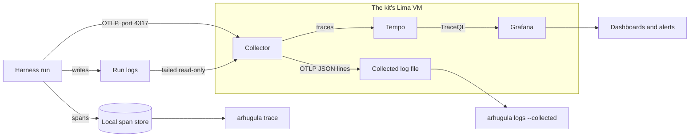

# Observability

This page is for the operator who wants to see what the harness did: its traces, its logs, its dashboards and its alerts.
After reading it you can read traces with no extra software, start and stop the observability tier, sign in to Grafana, and read each dashboard.

The observability tier is a *kit extension* built on the Compose project that upstream ships.
It needs Lima; see [the dependency list in the install guide](install.md#dependencies).
For every flag of every verb, see [the command reference](reference/cli.md).

## Contents

- [What you have with the tier off](#what-you-have-with-the-tier-off)
- [How the data flows](#how-the-data-flows)
- [Read traces from the local span store](#read-traces-from-the-local-span-store)
- [Set up the virtual machine](#set-up-the-virtual-machine)
- [Start and stop the tier](#start-and-stop-the-tier)
- [Sign in to Grafana and find a trace](#sign-in-to-grafana-and-find-a-trace)
- [Read the seven dashboards](#read-the-seven-dashboards)
- [Tune the seven alert rules](#tune-the-seven-alert-rules)
- [Read the collected logs](#read-the-collected-logs)
- [How runs are labelled and sampled](#how-runs-are-labelled-and-sampled)
- [Limits](#limits)
- [Sources](#sources)

## What you have with the tier off

You can inspect every run without the tier.
The runtime itself writes each run's spans to the local span store, and it writes the ledgers and the audit records.

| With the tier off you have | Where |
| --- | --- |
| The local span store | `<home>/state/observability/spans.sqlite` |
| The run logs | `<home>/logs/`, read with `arhugula logs` |
| Ledgers, memory and audit records | `<home>/state/` |

With the tier off, the runtime still sends each trace to the loopback endpoint `127.0.0.1:4317`.
Nothing listens there, so the trace is dropped.
Each run then prints a few retry lines from the OpenTelemetry Protocol exporter.
Program output shortens that protocol's name to `OTLP`.
Those lines are harmless.

The tier adds three things: Tempo, which stores traces for search; Grafana, with dashboards and alert rules; and a logs pipeline.

## How the data flows

The diagram shows three paths:

- **To the local span store.** The harness writes spans straight to the store on every run.
- **To Grafana.** The harness sends the same spans to the collector. The collector passes them to Tempo, and Grafana queries Tempo.
- **To the collected log file.** The collector tails the run logs and writes them to a file.



## Read traces from the local span store

The runtime creates the local span store on the first run.
No bridge process is needed: `arhugula collector bridge start` and `stop` only say so.

Show where the store is and how much it holds:

<!-- witness -->
```sh
arhugula collector status
```

```text
span store: <home>/state/observability/spans.sqlite: 871 spans in 59 traces; newest span ended 2026-11-14 21:36:12
written by: the runtime itself, on every run (`[runtime.collector] span_store_path` in the generated config)
read by:    arhugula trace list | browse | export, and arhugula eval sample
```

List the newest traces.
`arhugula trace list` is a *kit extension*; the default limit is 20.

<!-- witness -->
```sh
arhugula trace list --limit 5
```

```text
started              took   spans  workflow              status  trace id
2026-11-14 21:36:12  0.1 s  11     example-ollama-first  ok      8a6be66335912d11d4593a0d9f35d278
2026-11-14 21:32:09  0.7 s  11     example-ollama-first  ok      807ca5f2e1101786c5900be851d8205c
2026-11-14 21:16:33  0.0 s  9      example-ollama-first  error   e0088d4b5d569264200b45c7b0498464
2026-11-14 21:16:29  0.6 s  21     example-ollama-first  error   538b0e4f5630e2d9f24639dd06fa7bdb
2026-11-14 21:13:33  0.1 s  11     example-ollama-first  ok      2db9ad87a2593d68c8328ec47abbd2f9
```

Both outputs above come from the development deployment (*witnessed*).

Two more verbs read the same store:

- **`arhugula trace browse`** opens the runtime's terminal trace browser. It needs a terminal.
- **`arhugula trace export [--trace-id <id>] [--out <file>]`** writes spans as JSON lines, one span on each line. It is a *kit extension*.

```sh
arhugula trace export --trace-id <trace-id> --out trace.jsonl
```

The store keeps spans for 7 days by default.
The feature `collector-tuning` raises that to 30 days.
`arhugula feature show collector-tuning` shows what it changes, and `arhugula feature enable collector-tuning` turns it on.

## Set up the virtual machine

The stack runs in containers, and the containers run in a Lima virtual machine (VM).
**Docker Desktop is not required and is never used.**

By default the VM is the kit's own.
`init` question 11 offers it as the answer `kit` when Lima is installed.
You can also create it later:

```sh
arhugula observability vm create
```

Allow 5 to 10 minutes the first time, and about 1 minute when the image is cached.
The verb needs Lima 2.0.0 or later.

### What the VM contains

| Property | Value |
| --- | --- |
| Location | `<home>/lima` |
| Name | `arhugula` |
| Guest | Ubuntu LTS, built for the central processing unit (CPU) of your machine |
| Size | 2 processors, 4 GiB of memory, a 20 GiB disk |
| Software | Docker Engine, the Compose plugin, gVisor (`runsc`) |

### What the VM can see

The kit's VM sees two directories of the home, both read-only:

- **`<home>/observability`**, the rendered Compose project.
- **`<home>/logs`**, the run logs.

Your keys, your secrets and the state root stay on the host.
The one exception is the Grafana password, which `arhugula observability up` copies into a root-only directory inside the VM.
An instance you chose with `arhugula observability vm use` sees whatever you mounted in it.

### The four VM verbs

| Verb | What it does |
| --- | --- |
| `arhugula observability vm create` | Creates the kit's VM and proves that Docker, Compose and gVisor answer |
| `arhugula observability vm use <lima-home>::<instance>` | Uses a Lima instance you already have instead of the kit's VM |
| `arhugula observability vm status` | Shows the VM and the software inside it |
| `arhugula observability vm delete [--yes]` | Deletes the kit's VM. Without `--yes` it only says what it would delete |

`arhugula observability vm use` accepts an instance only if it is built for your machine's CPU.
The verb refuses an instance built for another CPU architecture and says why.
It also refuses while the stack is running in the current VM.
The instance must also see `<home>/observability` and `<home>/logs` at the same paths as on the host.
The verb does not check that; `arhugula observability up` does, and refuses if the instance cannot see the Compose project.

`arhugula observability vm delete --yes` also deletes the traces and the Grafana data stored inside the VM.
It refuses while isolation tier 3 is on, because that tier runs tools in this VM.
See [security and isolation](security-and-isolation.md).

This is `arhugula observability vm status` on the development deployment (*witnessed*):

```text
engine choice: kit
VM:            arhugula: Running, vz, aarch64, 2 CPU, 4 GiB, LIMA_HOME=<home>/lima
inside it:     Docker 29.9.3, Compose 5.7.1, gVisor runsc
```

## Start and stop the tier

### Start the tier

```sh
arhugula observability up
```

`arhugula observability up` does these steps in order:

1. It renders the Compose project into `<home>/observability`. The project is upstream's files, copied from the pinned commit, plus the kit's dashboards, alert rules and logs pipeline.
2. It starts the VM. If the kit's VM does not exist yet, it creates it. If you answered `n` at `init` question 11, the deployment has no VM choice: `up` refuses and names `arhugula observability vm create`.
3. It checks that the VM can see the Compose project.
4. If the stack is not running, it checks that the four loopback ports are free.
5. It generates the Grafana password if none exists, and places it in the VM.
6. It starts the three containers: the collector, Tempo and Grafana.
7. It restarts any running service whose configuration changed since the last start.
8. It waits up to 300 seconds until Grafana, Tempo and the trace endpoint answer on loopback.
9. It prints the Grafana address and turns the tier on in the deployment's configuration.

Do not edit `<home>/observability` by hand. The next `up` overwrites it.

The stack listens on loopback only:

| Port | Address | Used by |
| --- | --- | --- |
| Grafana | `127.0.0.1:3000` | Your browser |
| Tempo | `127.0.0.1:3200` | Tempo's query API |
| OTLP gRPC | `127.0.0.1:4317` | The harness, which sends traces here |
| OTLP HTTP | `127.0.0.1:4318` | Any other OpenTelemetry Protocol sender |

### Check the tier

<!-- witness -->
```sh
arhugula observability status
```

This is the output on the development deployment (*witnessed*):

```text
tier:    on
VM:      arhugula: Running, vz, aarch64, 2 CPU, 4 GiB, LIMA_HOME=<home>/lima
engine:  Docker 29.9.3, Compose 5.7.1, gVisor runsc

service         state
grafana         running
otel-collector  running
tempo           running

port       address         state
Grafana    127.0.0.1:3000  listening
Tempo      127.0.0.1:3200  listening
OTLP gRPC  127.0.0.1:4317  listening
OTLP HTTP  127.0.0.1:4318  listening

newest trace in Tempo: 2026-11-14 21:32:09  workflow.envelope  807ca5f2e1101786c5900be851d8205c
local span store:      <home>/state/observability/spans.sqlite: 871 spans in 59 traces; newest span ended 2026-11-14 21:36:12
```

The last two lines show the newest trace in each store: Tempo and the local span store.

### Stop the tier

```sh
arhugula observability down
```

`arhugula observability down` stops the stack and turns the tier off.
The tier stays off until the next `arhugula observability up`.
A later upgrade, relocation or re-verification does not start a stack that you took down.

| Flag | Effect |
| --- | --- |
| (none) | Stops the containers. Stored traces and Grafana data are kept |
| `--stop-vm` | Also stops the VM. Use this before `arhugula relocate` |
| `--delete-data` | Also deletes the stored traces and the Grafana data |

## Sign in to Grafana and find a trace

1. Open `http://127.0.0.1:3000` in a browser.
2. Sign in as the user `admin`.
3. Use the password in the file `<home>/secrets/grafana-admin-password`.

The kit generates the password once.
The file has mode 0600, is never in git and is never in a backup.

To find a trace, open Explore in Grafana and choose the Tempo data source.
Search for the service name `arhugula-harness`, or paste a trace ID from `arhugula trace list`.
Tempo also answers its own API at `http://127.0.0.1:3200`.

*Witnessed*: a run's trace appeared in Tempo with `rootServiceName = arhugula-harness`, and the same trace was in the local span store.

## Read the seven dashboards

Grafana loads seven dashboards into the folder "Arhugula Harness".
They are a *kit extension*.

All seven share these properties:

- **Data source.** Every panel queries Tempo with TraceQL.
- **The Project selector.** It filters on the project that ran the workflow. "All" shows every project.
- **Time range.** The default is the last 6 hours. No panel can look back further than 24 hours.
- **An "About this dashboard" panel.** It states what the dashboard answers and which runs produce its data.

[The panel index](../observability/PANELS.md) lists every panel with its query.
The sections below name the main panels only.

### LLM calls

It answers: how many large language model (LLM) calls ran, how fast, on which provider and model, with how many tokens, and which failed.

- **Totals.** LLM calls, Failed LLM calls, Input tokens, Output tokens.
- **Rate and latency.** Call rate by provider and by model; latency p50 and p95 by provider and by model.
- **Mix.** Provider mix, Model mix, Calls by routing layer.
- **Subscription routes.** CLI-reported input and output tokens, and Failed subscription CLI calls.
- **Tables.** Recent LLM calls and Recent failed LLM calls.

Every run that calls a model produces data here.

### Routing and resilience

It answers: how often a dispatch retried, how each attempt ended, when a fallback chain was exhausted, and when a circuit breaker changed state.

- **Totals.** LLM attempts, Retried attempts, Exhausted fallback chains, Breakers opened.
- **Attempts.** Attempts by terminal outcome and by attempt number; Failed attempts by fail class and by cause.
- **Fallback and breaker events.** `fallback.triggered`, `fallback.exhausted`, `retry.skipped` and `breaker.tripped` over time.
- **Timeouts.** Human gate timeouts (the panel title says `HITL`, for human in the loop), Tool invocation timeouts, and Provider attempts ending retry or max-attempts.
- **Tables.** Recent failed workflow runs, Recent attempts that did not succeed, Recent exhausted fallback chains.

Fallback and breaker panels fill only when a run meets a failing or unavailable model.
No span carries a deadline or timeout attribute, so the dashboard shows timeouts through four signals: those three panels and "Spans that ended with an error".

### Human-in-the-loop gates

It answers: how often a gate was evaluated, how many times a person was asked, how they answered and how quickly.

- **Totals.** Gate evaluations, Invocations opened, Invocations answered, Invocations timed out.
- **Gates.** Gate evaluations by level, by human requirement and by persona tier.
- **Answers.** Responses by class, Response latency p50 and p95, Slow responses (over 60 s), Responses by ingress.
- **Timeouts and pauses.** Timeouts by degradation mode, Pauses by reason, Webhook delivery attempts by status.
- **Tables.** Recent gate invocations, Recent answers and timeouts.

A workflow with no gate produces no data here, and every panel then shows "No data".

### Validators

It answers: how validator checks ended, which steps fail validation, and how often a failure went to a person.

- **Totals.** Validator checks, Checks that did not pass, Permanent failures, Escalations.
- **Outcomes.** Outcomes, Outcomes per step, Fail classes, Next action after a failed check.
- **Escalations.** Escalations by fail class and per step.
- **Tables.** Recent checks that did not pass, Recent escalations.

Only workflows whose steps declare a validator produce data here.

### Cost

It answers: how much cost, in US dollars, the harness attributed to LLM calls and tool calls.

- **Totals.** Attributed cost, Spans with a cost, LLM calls in total, Tool calls with a cost.
- **Over time.** Attributed cost over time, Cost by provider, Cost by model.
- **Breakdowns.** Total cost by provider and model, Total cost by workflow, Tool cost by tool.
- **Coverage.** Priced and unpriced LLM calls by provider.
- **Table.** Recent calls with a cost.

The runtime writes cost as text.
The kit's collector copies it into the number `cost.attributed_number`, which these panels sum.
Local Ollama calls are priced at a rate of zero, so they appear with a cost of 0.
The rates come from the harness rate table, whose defaults are placeholders for you to override.

### Memory

It answers: which memory operations ran, which failed or were denied, and how models used the memory tools.

- **Totals.** Memory operations, Operations with a failure class, Denials, Memory tool calls.
- **Operations.** By name, by kind, by access mode, by policy decision, by tier and by provider.
- **Failures.** Failures by class, Denials by reason, Degraded serves by reason.
- **Memory tools.** Calls by tool and by policy decision, call failures by class, Unserved memory tool calls.
- **Tables.** Recent failures and denials, Recent memory tool calls.

A failure class does not always mean an error.
`retrieval_empty_result` and `policy_denial` appear on operations that completed normally.
See [memory](memory.md).

### Evaluation

It answers: what the traces can show about the five evaluation primitives, and whether a drift event was recorded.

- **Primitive 1.** Answered human gates, Workflow runs, Answered human gates over time.
- **Primitive 2.** Sandbox violations, by fail class and over time.
- **Primitive 4.** Cache read input tokens and Cache creation input tokens, in total and by model.
- **Scores and drift.** Evaluation scores by primitive, Drift events, Recent drift events.

Primitives 3 and 5 have text panels only, because no span carries a reviewer's verdict.
The score and drift panels stay empty, because no normal run writes those spans.
See [evaluation](evaluation.md).

## Tune the seven alert rules

Grafana loads seven alert rules into the rule group `arhugula-harness`.
They are a *kit extension*.
Grafana evaluates each rule every minute.
A rule fires as soon as its condition holds, and it treats "no data" as healthy.

| Rule | Fires when | Window | Threshold source |
| --- | --- | --- | --- |
| Workflow run failed | More than 0 workflow runs failed, for each project and workflow | 10 minutes | Kit default |
| Fallback chain exhausted | More than 0 dispatches ran out of candidates | 10 minutes | Kit default |
| Circuit breaker opened | More than 0 circuit breakers opened | 10 minutes | Kit default |
| Human gate timed out | More than 0 human gates timed out | 10 minutes | Kit default |
| Validator failed permanently | More than 0 validator checks failed permanently | 10 minutes | Kit default |
| Attributed cost above threshold | Attributed cost exceeds 1 US dollar for a project | 60 minutes | Kit default |
| Alignment-floor drift detected | More than 0 drift events were recorded | 10 minutes | Upstream's rule: any drift event is a breach |

The six kit defaults are starting points for you to tune.
The cost threshold in particular is a guess: 1 US dollar an hour for each project.

All rules go to Grafana's default contact point.
That contact point sends nothing outside your machine until you configure it in Grafana.

*Witnessed*: the rules fired on real failed runs.
[The panel index](../observability/PANELS.md) lists each rule's query.

## Read the collected logs

The logs pipeline is a *kit extension*.
The collector tails every `*.log` file under `<home>/logs`.
It writes each line in the OpenTelemetry Protocol's JSON form to one file inside its own storage.
It rotates that file at 20 MB.

No logs backend is installed.
You read the file with one flag:

```sh
arhugula logs --collected --lines 20
```

Before the collector has written anything, the verb prints `the logs pipeline has written nothing yet`.
It refuses when the collector is not running, and prints the fix: `arhugula observability up`.

The same verb reads the run logs directly, with the tier on or off:

| Command | Shows |
| --- | --- |
| `arhugula logs` | The newest log file, last 60 lines |
| `arhugula logs --list` | Every log file with its time and size |
| `arhugula logs <name> --lines <N>` | The named log file |

`arhugula logs` takes no `--project`.
A run log's name starts with `run-<project>-`, so you can pick a project's logs from the list.

## How runs are labelled and sampled

### Resource attributes

The kit sets two resource attributes in every generated config.
The runtime sets no service name itself; without one, a trace backend files every run under `unknown_service`.

| Attribute | Value | Used for |
| --- | --- | --- |
| `service.name` | `arhugula-harness` | Finding the harness's traces in Tempo |
| `service.namespace` | The project name, or `default` for the deployment default | The Project selector, and the per-project alert rules |

### Sampling

At this pin every trace is kept.
The deployment runs on the surface `local-development`, whose mode is head-based development sampling.

The feature `tail-sampling` sets `sampling_mode = "TAIL_BASED_PROD"` in the config.
That setting changes nothing at this pin (*upstream limit*).

## Limits

- **24-hour retention.** Tempo keeps traces for 24 hours. For older runs, use the local span store, which keeps 7 days by default.
- **Empty metric panels after a Tempo restart.** Metric panels stay empty until the next run writes a span (*upstream limit* of Tempo's generator). Run any workflow to fill them.
- **No finish reasons.** The harness declares the finish-reason attribute and never writes it to a span (*upstream limit*). A failed call shows only as an error status.
- **No per-step span.** A workflow step has no span of its own (*upstream limit*).
- **Subscription routes show no cost.** Calls through `claude_code`, `codex`, `gemini` and `antigravity` are never priced, by design (*upstream limit*). They add nothing to the Cost dashboard. That does not mean the calls were free under your subscription.
- **No logs backend.** The logs pipeline writes a file. Grafana does not show logs.
- **No drift events from normal runs.** The evaluation dashboard's score and drift panels, and the drift alert rule, stay silent (*upstream limit*).

More limits are in [known gaps](reference/known-gaps.md).
When a verb here fails, see [troubleshooting](troubleshooting.md).

## Sources

Kit modules and files:

- `kit/lib/arhugula_kit/observability.py`
- `kit/lib/arhugula_kit/verbs_observability.py`
- `kit/lib/arhugula_kit/vm.py`, `lima.py`, `render.py`, `layout.py`
- `kit/observability/stack/` (`compose.kit.yaml`, `otel-collector.yaml`, `tempo.addendum.yaml`, `grafana-dashboards.yaml`)
- `kit/observability/lima/arhugula.yaml.tmpl`
- `kit/observability/dashboards/`, `kit/observability/alerting/arhugula-rules.yaml`, `kit/observability/PANELS.md`
- `kit/fragments/tail-sampling.toml`, `collector-tuning.toml`

Upstream documents and code:

- `upstream/deploy/self-hosted-local/README.md`
- `upstream/deploy/self-hosted-local/compose.yaml`, `otel-collector.yaml`, `tempo.yaml`
- `upstream/harness-od/src/harness_od/sampling_mode.py`
- `upstream/harness-runtime/src/harness_runtime/types.py` (the span store's retention)
