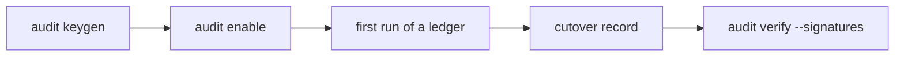

# Security and isolation

This page is for the operator who runs a deployment and for the reviewer who judges it.
After reading it you can keep secrets out of files, sign and verify the audit ledger, set what a gate approves without asking, and run tool calls in a sandbox.
You also learn what each mechanism does not protect against.
Tool calls go to tool servers that speak the Model Context Protocol (MCP).

This page describes kit version 0.1.0.
To install the deployment first, read [the install guide](install.md).
For the limits in one list, read [the known gaps](reference/known-gaps.md).

Three markers in italics tell you how far to trust a statement:

- ***witnessed*:** it ran on the development machine and the evidence exists.
- ***kit extension*:** the kit adds it; it is not part of the upstream harness.
- ***upstream limit*:** it does not exist, or does not work, at the pinned upstream commit.

A statement with no marker was read in the code and not run for this page.

## Contents

- [What each mechanism protects](#what-each-mechanism-protects)
- [Keep secrets out of files](#keep-secrets-out-of-files)
- [Sign the audit ledger](#sign-the-audit-ledger)
- [Set what a gate approves without asking](#set-what-a-gate-approves-without-asking)
- [Declare how far you trust an MCP server](#declare-how-far-you-trust-an-mcp-server)
- [Run tool calls in a sandbox](#run-tool-calls-in-a-sandbox)
- [How provider calls are isolated](#how-provider-calls-are-isolated)
- [What the virtual machine can see](#what-the-virtual-machine-can-see)
- [Sources](#sources)

## What each mechanism protects

Every mechanism here guards one thing and leaves the rest alone.
None of them protects against a person or a program that already runs as your macOS user.

| Mechanism | What it does | What it does not do |
| --- | --- | --- |
| Keychain for API keys | Keeps hosted API keys out of every file of the deployment. | It does not stop a program that runs as you from asking the keychain. |
| Private files and directories | Stops other users of the Mac from reading keys, the Grafana password, state, backups and run logs. | It does not encrypt anything. It does not cover the configuration. |
| Audit hash chain | Shows an entry that was changed or removed while the hashes after it stayed as they were. | It is not a signature. Whoever can write the ledger can recompute the hashes, or remove entries from the end. |
| Audit signing | Makes a forged entry need the signing key. | It does not protect a ledger if the key file is copied, and every program that runs as you can read that file. It does not show entries removed from the end. |
| Approval gates | Ask you before a tool call that the workflow puts a gate in front of. | They do not cover a tool call that no gate names. They do not ask for calls the policy approves without asking. |
| Isolation tier 3 | Runs a tool call in a gVisor container with no network, inside the virtual machine. | It does not sandbox provider calls or tier 1 tool calls. It does not sandbox the MCP server process, which still starts on the Mac. |
| Provider-call isolation | Removes API keys from the environment. For Claude Code and Codex it also switches the provider's tools off. | It does not hide your home directory from the provider's program. It passes no flag that switches Gemini's tools off. |
| Routing and the fallback chain | Choose which provider serves a step. | They are not a data boundary. A step that fails on its provider goes to the next provider of the chain with the same prompt. `--provider` only puts a provider in front of the whole chain. To keep every step on one provider, make it the chain's only entry: `arhugula routing chain set <binding> --fallback none`. See [Change the routing](providers.md#change-the-routing). |

## Keep secrets out of files

### Store an API key in the keychain

A hosted API provider needs a key.
The key goes into the macOS keychain and into no file.
Run this in your own terminal, with the provider's name from `arhugula provider list`:

```sh
arhugula provider key set <name>
```

The command asks for the key at a hidden prompt, so the key reaches neither your shell history nor a log.
It stores the key in the keychain service `harness`.
`arhugula provider key delete <name>` removes it.

These rules hold for keys:

- **No key in TOML.** The runtime's loader refuses a configuration file with a value under a key whose name ends in `api_key`, `secret`, `password`, `passphrase`, `token` or `credential`. It checks the name of the key and not the value, so it does not catch a secret under another name, such as a token inside a URL.
- **An environment variable is a fallback.** When the keychain has no entry, the runtime reads `ANTHROPIC_API_KEY` or `OPENAI_API_KEY` from the environment. Unset them if you want the keychain to be the only source.
- **Subscription providers use no key.** Claude Code, Codex, Gemini and Antigravity each keep their own sign-in. The deployment never reads it.
- **An MCP credential lives in the keychain too.** `arhugula mcp add --auth-secret-name <entry>` names a keychain entry; the credential itself stays out of the configuration. The runtime sends the credential as a bearer token, and refuses the flag for a `stdio` client.

No `arhugula` verb stores an MCP credential.
Create the keychain entry in your own terminal; [Keep secrets out of TOML](configure.md#keep-secrets-out-of-toml) explains the command:

```sh
security add-generic-password -s harness -a <entry> -w
```

The service and the account are read in the runtime's code; this command was not run.

### Know where the Grafana password is

The kit generates the Grafana admin password once, when the trace stack first starts (*kit extension*).
It writes the password to `<home>/secrets/grafana-admin-password`.
The user name is `admin`.

The kit also copies the password into the virtual machine, because Grafana runs there.
Inside the virtual machine the copy sits in a directory that only the machine's root user can enter.
That does not keep it from the machine's ordinary user: that user controls the Docker engine there, and read the file through a container (*witnessed*).
The password guards Grafana only.
Tempo and the collector ask for no password; see [what the virtual machine can see](#what-the-virtual-machine-can-see).

### Check which files are private

| Path | Mode | What it holds |
| --- | --- | --- |
| `<home>/keys/` | 0700 | the signing keys |
| `<home>/keys/audit-ed25519.pem` | 0600 | the private key that signs audit entries |
| `<home>/keys/audit-cutover-ed25519.pem` | 0600 | the private key that signs cutover records |
| `<home>/secrets/` | 0700 | secrets the kit generates |
| `<home>/secrets/grafana-admin-password` | 0600 | the Grafana admin password |
| `<home>/state/` | 0700 | ledgers, memory, pause journals and the local span store |
| `<home>/state/pause-journal/` | 0700 | the journals of paused runs |
| `<home>/backups/` | 0700 | backup archives |
| a backup archive | 0600 | see the next section |
| a run log in `<home>/logs/` | 0600 | what a run printed, which can quote prompts and tool output |

Mode 0700 means only your user can enter the directory.
Mode 0600 means only your user can read or write the file.
The public keys and the key map in `<home>/keys/` are readable by design: they verify signatures and sign nothing.
The files in `<home>/config/` are not private and hold no secret.

The kit sets no mode on the home directory or on the directory `<home>/logs/`.
On the development deployment other users of the Mac can list the home and the names of the run logs.
They cannot read a run log.
A log that an earlier kit wrote keeps the mode it had.

These modes protect against other users of the Mac.
Nothing here is encrypted, so a program that runs as you can read every one of these files.

### Know what a backup contains

`arhugula state backup` writes one archive to `<home>/backups/` (*kit extension*).
Stop the daemon first so the archive is consistent.

| In the archive | Not in the archive |
| --- | --- |
| the state root `<home>/state/`: ledgers, memory, pause journals, the local span store | `<home>/keys/`: back up both private keys yourself |
| the answers file `<home>/config/init-answers.json` | `<home>/secrets/` |
| | keychain entries |
| | the virtual machine and the trace data in it |

`init` creates `<home>/backups/` with mode 0700.
`state backup` sets that mode again on every run.
With `--output <file>` the archive goes where you say, and the directory there is yours to protect.

The archive has mode 0600 from its first byte, and a backup that fails leaves no partial archive behind.
The archive is not encrypted.
It holds everything your workflows remembered, so store a copy as carefully as the state root itself.

`arhugula state restore <archive>` moves the current state root aside and keeps it; it deletes nothing.
The earlier state root stays at `<home>/state.before-restore-<time>/`, with mode 0700, until you delete it.
`arhugula memory export` also writes to `<home>/backups/`, and sets the directory's mode to 0700 when it does.
Its archive has mode 0600 from its first byte too.

`arhugula uninstall --yes` keeps state, keys, secrets and backups.
Only `--delete-state` removes them.
Neither form removes a keychain entry or a `state.before-restore-<time>/` directory.
Neither form removes the download caches that uv and Lima keep outside the home.
Remove a key with `arhugula provider key delete <name>` before you uninstall.

## Sign the audit ledger

Each project has a ledger, and the deployment has a default one.
The runtime links the audit entries of a ledger in a hash chain.
Signing adds a signature to every new entry, made with a key file in `<home>/keys/`.



The diagram shows the order.
You create the keys, then switch signing on.
At the first run of an empty ledger the runtime writes that ledger's cutover record.
Full verification needs that record.

### Create the two keys

```sh
arhugula audit keygen
```

Upstream ships no key generator (*upstream limit*), so the kit adds this verb (*kit extension*).
If you chose the feature `s` at `init`, init already created both keys and you can skip this command.
It writes two Ed25519 key pairs and a key map into `<home>/keys/`:

- **The entry key** signs every audit entry.
- **The record key** signs each ledger's cutover record. That record lists the entries that may go without a signature. For a ledger signed from its first entry the list is empty, so every entry must carry a valid signature.
- **The key map** lists the public keys. `arhugula audit verify` reads it.

The runtime requires the record key to be different key material from the entry key.
The reason: someone who copies the entry key can then forge entries, but cannot forge a record that excuses unsigned ones.
Both keys sit in the same directory with the same mode, so a program that can copy one can copy both.

The keys are unencrypted files, and one fixed key signs for the life of the ledger: there is no key rotation (*upstream limit*).
No archive contains them, so back up both private keys yourself.

### Switch signing on

```sh
arhugula audit enable
```

Every audit entry of every later run is now signed.
The command names each ledger that already holds unsigned entries.

Whether a ledger verifies in full depends on when signing began:

| The ledger | What you can verify |
| --- | --- |
| was empty when signing was switched on | everything: the hash chain and every signature (*witnessed*: `VERIFIED`) |
| already held entries when signing was switched on | the hash chain only (*upstream limit*) |

An unsigned entry never verifies, and the runtime writes no cutover record for a ledger that began unsigned.
Writing that record afterwards does not help.
Upstream's `harness migrate-audit-sidecar --author` was tried on such a ledger, and verification then fails with `signature-invalid` on the unsigned entries (*witnessed*).

To have every ledger signed from its first entry, switch signing on during `init`: choose the feature `s` at the features question.
Init then creates both keys itself.
A project you attach after `arhugula audit enable` is also signed from its first entry.

`arhugula audit disable` stops signing new entries.
Entries already written keep their signatures.
A ledger that then receives unsigned entries no longer passes `arhugula audit verify --signatures`.

### Check the signing state

<!-- witness -->
```sh
arhugula audit status
```

Output on the development deployment, where the keys exist and signing is switched off:

```text
backend:     none
entry key:   present (<home>/keys/audit-ed25519.pem)
record key:  present (<home>/keys/audit-cutover-ed25519.pem)
key map:     present (<home>/keys/signing-key-map.json)

project             audit entries  verifies
deployment default  37             hash chain only: signing is off
demo                16             hash chain only: signing is off
```

The column `verifies` shows one of these values:

| Value | Meaning |
| --- | --- |
| `hash chain only: signing is off` | Signing is off. `arhugula audit verify` checks the chain. |
| `hash chain only: it began unsigned` | Signing is on, but this ledger held entries before. |
| `in full, from its first run (the runtime writes its cutover record then)` | Signing is on and the ledger is still empty. |
| `in full: signed from its first entry` | The cutover record exists. |

### Verify a ledger

```sh
arhugula audit verify --project <project>
arhugula audit verify --project <project> --signatures
```

The command chooses the check from the ledger, with or without the flag:

| The ledger | What the command checks |
| --- | --- |
| has a cutover record, and the key map exists | the hash chain, every signature and the cutover record |
| any other ledger | the hash chain only |

`--signatures` requires the full check.
With it, the command refuses a ledger that cannot have the full check and tells you why.
Pass it where a hash-chain check alone must not count as a pass, for example in a script.

The last line of the output says which check ran.
After the full check it says `the hash chain is intact and every entry's signature verified`.
After the hash-chain check it says `the hash chain is intact (this ledger carries no cutover record, so signatures were not checked)`.

The runtime's inspector does the work, and its exit code is the result:

| Exit code | Meaning |
| --- | --- |
| 0 | The check that ran passed. |
| 3 | `UNVERIFIED`: the inspector lacked an input, and its message names it. |
| 4 | Verification ran and failed; the message names the entry. |

A passing result proves less than it may seem to:

- **The hash chain has no key.** A program that can write the ledger can change an entry and recompute every hash after it. The hash-chain check then passes.
- **Nothing records how long a ledger should be.** Entries removed from the end of the ledger and of its audit file leave a chain that passes with and without `--signatures`. The inspector prints `head_hash`; note it somewhere else if you need to detect this.
- **Verification trusts the files in `<home>/keys/`.** A program that runs as you can read the private keys, sign new entries and replace the key map. Keep a copy of the public keys outside the Mac if you need to rule that out.
- **The signature shows which key signed.** It does not show which person or program used the key.

### Make a step fail when its entry cannot be signed

By default a step whose audit entry cannot be signed still proceeds.
The feature `audit-fail-closed` changes that: the step fails instead.
The runtime then holds the step's result in an encrypted store until the entry is written.

```sh
arhugula feature show audit-fail-closed
arhugula feature enable audit-fail-closed
```

This feature needs audit signing.
It also needs the environment variable `HARNESS_PROTECTED_RESULT_STORE_KEY`, holding a base64 Fernet key, in the shell that runs your workflows.
That key is a secret in your environment, and you manage it yourself: the kit does not create or store it.
This feature was not run for this page.

### Migrate an old ledger

`arhugula audit migrate-sidecar` runs the runtime's one-time audit sidecar migration on a project's ledger.
You need it only for a ledger written before the audit sidecar existed.
A new deployment never needs it.

## Set what a gate approves without asking

An approval gate stops a tool call and asks you.
A gate exists only where the workflow places one: the `hitl_placements` line of the workflow file names the tools it covers.
A tool call that no placement names runs without asking, whatever the policy says.
The policy decides which calls a gate approves on its own, without asking.
The policy applies to workflows that run as the `solo-developer` persona.

The gate floor and this policy read that persona from the workflow file's `persona_tier`.
They do not read the deployment's `persona_tier` setting, which decides trace sampling, trace redaction and prompt-version approval, and the runtime does not compare the two.

<!-- witness -->
```sh
arhugula policy show
```

Output with the default policy:

```text
What an approval gate approves without asking (solo-developer persona):
  solo-floor-auto:            on   read-only tool calls at the solo floor
  local-mutation-floor-auto:  off  tool calls that change local files

With a setting off, the gate asks you in the terminal. A run without a terminal rejects the gate.
```

| Setting | Default | When it is on |
| --- | --- | --- |
| `solo-floor-auto` | on | A gate approves read-only tool calls without asking. |
| `local-mutation-floor-auto` | off | A gate also approves tool calls that change local files. |

Change a setting with `arhugula policy set`:

```sh
arhugula policy set solo-floor-auto off
```

With `solo-floor-auto` off, a gated tool call asks at the terminal (*witnessed*).
The answer `approve` let the run complete.
Answer within the step deadline, 30 seconds unless set: [Enable, disable and tune a provider](providers.md#enable-disable-and-tune-a-provider) shows how to raise it.

Four limits apply:

- **No setting approves external changes.** The policy has no switch for tool calls that change something outside the Mac. It cannot make a gate approve them.
- **A run without a terminal rejects a gate.** The runtime answers `noninteractive: no operator terminal` (*upstream limit*).
- **The policy does not see what a tool does.** The runtime does not inspect a tool. It gives every tool of a client the blast radius that you declared with `--blast-radius`, and a gate follows that declaration: see [Declare how far you trust an MCP server](#declare-how-far-you-trust-an-mcp-server). To make a gate ask before a tool that is declared `READ_ONLY`, switch `solo-floor-auto` off.
- **The workflow file decides where gates are.** Whoever writes the workflow chooses its gates and its `persona_tier`, so read a workflow you did not write before you run it.

## Declare how far you trust an MCP server

An MCP client connects the runtime to a tool server.
When you add one, you declare two things about it.
See every flag with:

```sh
arhugula mcp add --help
```

| Flag | Values | Default |
| --- | --- | --- |
| `--trust` | `L0_REFUSE_REMOTE`, `L1_SIGNED_PINNED`, `L2_SANDBOX_ALL`, `L3_ALLOW_WITH_AUDIT` | `L3_ALLOW_WITH_AUDIT` |
| `--blast-radius` | `READ_ONLY`, `LOCAL_MUTATION`, `EXTERNAL_REVERSIBLE`, `EXTERNAL_IRREVERSIBLE` | `READ_ONLY` |

The blast radius is the most the server's tools can change.
Both values are your declaration: the kit passes them to the runtime unchanged.

The kit writes the `--blast-radius` value to two settings of the client, `blast_radius` and `default_blast_radius`.
The runtime gives every tool of the client the value of `default_blast_radius`.
Its gates and its tier computation follow that value.
So with the default policy a gate approves a tool of a `READ_ONLY` client without asking.

### How the two values choose an isolation tier

The runtime computes the lowest isolation tier a client's tool calls may run at.
It starts from the blast radius that you declared:

| Blast radius | Lowest tier |
| --- | --- |
| `READ_ONLY` | tier 1 |
| `LOCAL_MUTATION` | tier 2 |
| `EXTERNAL_REVERSIBLE` | tier 3 |
| `EXTERNAL_IRREVERSIBLE` | tier 4 |

Then the transport and the trust level can raise it:

| Client | Result |
| --- | --- |
| any `stdio` client | tier 3, or the blast-radius tier when that is higher |
| a remote client at `L0_REFUSE_REMOTE` | refused when the client is registered |
| a remote client at `L1_SIGNED_PINNED` or `L3_ALLOW_WITH_AUDIT` | the blast-radius tier |
| a remote client at `L2_SANDBOX_ALL` | tier 4 |

The runtime never runs a call below the tier it computed.
This deployment provides tier 1 for every client, and tier 3 for `stdio` clients only.
So a remote client that resolves above tier 1 has no sandbox driver.
While such a client is configured, the runtime refuses every run at its start, with exit code 4.
A remote client at `L1_SIGNED_PINNED` or `L3_ALLOW_WITH_AUDIT` that you declare `READ_ONLY` resolves to tier 1 and runs.

A URL client added with `--blast-radius LOCAL_MUTATION` resolved to tier 2, and the next run ended with this message (*witnessed*):

```text
RT-FAIL-BOOTSTRAP: bootstrap failed at stage LOOP_INIT (6): SandboxDriverUnavailableError: resolved sandbox tier 'tier-2-container' requires an execution driver but MCPClientConfig.sandbox_driver is not configured — configure a driver or set the per-server sandbox tier to TIER_1_PROCESS (runtime spec v1.43 §14.9.9 FR-2(i))
```

To run again, remove the client with `arhugula mcp remove <name>`.

`arhugula isolation attach` gives a driver to a `stdio` client only.
It refuses any other client with this message:

```text
<client> is not a stdio client. The runtime runs only stdio clients' tools at tier 3; for other clients it picks the tier itself, and this deployment provides no other sandbox tier
```

`arhugula mcp add` prints a note about the tier rule.
With a blast radius other than `READ_ONLY`, it prints this after it adds the client, here for a client named `notes`:

```text
note: the runtime runs a client that can change things at a sandbox tier above 1. This deployment provides tier 3 only, and only for stdio clients. While a client needs a tier it does not have, the runtime refuses every run at its start (SandboxDriverUnavailableError). To undo: arhugula mcp remove notes
```

Not examined for this page: whether the runtime checks a signature or a version pin for `L1_SIGNED_PINNED`.

### Two features that make the policy explicit

| Feature | What it does |
| --- | --- |
| `trust-policy` | Replaces the runtime's default per-server trust policy with an explicit one. Every MCP server is sandboxed unless you list it, and every call below the audit tier is audited. |
| `sandbox-policy` | Declares the sandbox decision policy. At this pin the table has no fields, so it selects the runtime's default policy in writing and changes no behavior. |

Read each one before you switch it on:

```sh
arhugula feature show trust-policy
arhugula feature show sandbox-policy
```

With `trust-policy` on, list the servers you allow with `arhugula config set trust_policy.allow_list '["<name>"]'`.
Neither feature was run for this page.

## Run tool calls in a sandbox

An isolation tier says how strongly a tool call is separated from your Mac.
The runtime defines four tiers; this deployment provides two.

| Tier | What it means here | State |
| --- | --- | --- |
| tier 1, `tier-1-process` | The runtime calls the tool from its own process on the Mac. No sandbox is added. | The default for every tool call. |
| tier 2, `tier-2-container` | A container without gVisor. | Outside this deployment. |
| tier 3, `tier-3-microvm` | The tool call runs in a gVisor container inside the virtual machine. | Available after `arhugula isolation enable tier-3`. |
| tier 4, `tier-4-full-vm` | A full virtual machine, hosted or local. | Outside this deployment. |

Tier 1 is no protection against a tool that misbehaves.
At tier 1 a tool can do whatever its server can do.
The kit sets up no driver for tiers 2 and 4, and neither was run.

### See which tiers are in use

<!-- witness -->
```sh
arhugula isolation show
```

Output on the development deployment, with tier 3 enabled:

```text
tier 1 (host process): the default for every tool call on this deployment.
tier 3 (gVisor in the Lima VM): enabled
  container CLI: <home>/bin/gvisor-docker
  MCP client sandbox-echo (stdio): tier 3, image alpine:3.20
tiers 2 and 4 are outside this deployment (see docs/security-and-isolation.md).
```

### Enable tier 3

Tier 3 needs the deployment's virtual machine, because gVisor runs on Linux only.
Create the machine first if you have none: `arhugula observability vm create`.
What the machine needs is listed under [dependencies in the install guide](install.md#dependencies).

```sh
arhugula isolation enable tier-3
```

The command does four things:

1. It checks that the Docker engine inside the virtual machine lists the gVisor runtime `runsc`.
2. It writes `<home>/bin/gvisor-docker`, a one-line script that reaches that engine. The runtime uses it as its container command.
3. It pulls the image `alpine:3.20` inside the virtual machine.
4. It adds the MCP client `sandbox-echo`, a demonstration tool that echoes its argument from inside the sandbox.

The Docker engine is the one inside the virtual machine.
Docker Desktop is not required and is never used.

Keep one kind of MCP client configured at a time (*upstream limit*).
`sandbox-echo` is a `stdio` client. With it and an HTTP client from `arhugula mcp add` both configured, every run serves its tool calls and then ends with an error and exit code 1 (*witnessed*).
The known gaps describe [the limit on mixed MCP clients](reference/known-gaps.md#audit-and-isolation).

### Give your own MCP client a sandbox

The runtime runs every `stdio` MCP client at tier 3 or higher.
A `stdio` client therefore needs a tier 3 driver before its tools can run.

```sh
arhugula isolation attach <client> --image <image> --command '["python","/runner.py"]'
```

`<client>` is the name of a `stdio` client from `arhugula mcp list`.
`--image` is a container image that holds your tool runner.
`--command` is the runner inside the image, as a JSON array.
The runner reads one MCP request as JSON on standard input and writes one MCP result as JSON on standard output.

The driver the kit writes gives the container no network and allows each call 30 seconds.
It mounts nothing into the container.
It sets no limit on memory, processor time or process count.
It names no user, so the runner has the user the image sets.

The runner in the image answers the tool call; the MCP server you registered does not.
The runtime still starts that server on the Mac, as your user, to list its tools.

### Read the span labels

Each sandboxed tool call writes a span.
With tier 3 the labels were (*witnessed*):

| Label | Value |
| --- | --- |
| `sandbox.tier` | `tier-3-microvm` |
| `sandbox.tech` | `gvisor` |
| `sandbox.provider` | `runsc` |

The runtime derives these labels from the tier it resolves for the client.
The kit sets none of them.
If you set `default_sandbox_tech` or `default_sandbox_provider` on a client yourself, your value replaces the derived one, and the label can then name a sandbox that did not run.
The tier name says `microvm`, but the mechanism here is gVisor: a sandbox between the container and the Linux kernel of the virtual machine.

### Disable tier 3

```sh
arhugula isolation disable
```

This removes `sandbox-echo`, the driver of every client and the script `<home>/bin/gvisor-docker`.
It keeps your MCP clients.
A `stdio` client then has no driver, and the runtime refuses its tool calls.

### What tier 3 does and does not protect

- **It contains the tool runner.** The runner works in a gVisor container with no network, inside the virtual machine.
- **It does not contain the MCP server.** The runtime starts a `stdio` server on the Mac, as your user. Only the tool call goes to the sandbox.
- **It does not cover tier 1.** A remote, read-only client still runs at tier 1.
- **It does not cover provider calls.** A model call never runs in the sandbox.
- **It depends on the image.** The kit pulls the image you name and does not inspect it.

## How provider calls are isolated

Each agent step is one short-lived call to a provider.
For the four subscription providers the runtime starts the provider's own command-line program once per step.
It passes a reduced environment and a command line that runs the program in print mode, with no session.

| Provider | Environment the program receives | Working directory | Command line |
| --- | --- | --- | --- |
| `claude_code` | An allowlist only: `PATH`, `HOME`, user, locale, temporary directory, config directories, proxy and certificate variables. | A new empty directory, removed after the call. | `--print`, `--no-session-persistence`, `--safe-mode`, `--strict-mcp-config`, an empty `--tools` list, `--permission-mode dontAsk` |
| `codex` | Your environment without five credential variables. | A new empty directory, removed after the call. | `exec --ephemeral --sandbox read-only --ignore-user-config`, with the shell, plugin, browser and web-search features disabled |
| `antigravity` | Your environment without five credential variables. | The directory the runtime runs in. | `--print <prompt> --sandbox` |
| `gemini` | Your environment without five credential variables. | The directory the runtime runs in. | `--skip-trust -m <model> -p <prompt>` |

The five credential variables are `ANTHROPIC_API_KEY`, `OPENAI_API_KEY`, `GEMINI_API_KEY`, `GOOGLE_API_KEY` and `GOOGLE_APPLICATION_CREDENTIALS`.
Removing them keeps a subscription call from silently becoming a paid API call.
It also keeps the harness's keys away from the provider's program.

The runtime starts the program directly, with no shell, so a prompt cannot inject a shell command.

What this isolation does not do:

- **It is not a sandbox.** The program runs as your user. Its restraint comes from its own flags, and the runtime trusts the program to honor them.
- **It does not switch every provider's tools off.** Claude Code gets an empty tool list and Codex gets its tool features disabled. Antigravity gets `--sandbox` only. Gemini gets no flag that limits its tools.
- **It passes `HOME`.** The program needs its own sign-in, so it can reach your home directory.
- **It removes five variables, not all secrets.** For Codex, Antigravity and Gemini every other variable of your environment passes through.
- **It puts some prompts on the command line.** Antigravity and Gemini receive the prompt as an argument, which other programs of your user can see while the call runs.
- **Codex is marked HELD upstream.** Its filesystem read exposure is an untested boundary (*upstream limit*).

Hosted API providers and Ollama do not go through a command-line program, and this section does not describe them.

## What the virtual machine can see

The kit's own virtual machine hosts the trace stack and the tier 3 sandbox (*kit extension*).
It sees two directories of the home, both read-only:

| Directory on the Mac | Inside the virtual machine | Why |
| --- | --- | --- |
| `<home>/observability/` | `/arhugula/observability` | the Compose project of the trace stack |
| `<home>/logs/` | `/arhugula/logs` | the run logs the collector reads |

The virtual machine can see:

- **The run logs.** Whatever a run writes to its log is readable there.
- **The traces.** Your runs send their spans to the collector inside the machine.
- **A copy of the Grafana password.** Grafana needs it.
- **The network.** The machine downloads its images from the internet. A tier 3 container gets no network.
- **Services on the Mac's loopback address.** Lima gives the machine the name `host.lima.internal` for the Mac. A program in the machine reached Ollama through it, though Ollama listens on `127.0.0.1` only (*witnessed*). The same holds for any other service that listens there.

The virtual machine cannot see `<home>/keys/`, `<home>/secrets/`, `<home>/state/`, `<home>/config/`, your project repositories or the keychain.
None of them is mounted.

The trace stack listens on the loopback address only, on ports 4317, 4318, 3200 and 3000.
Another computer on your network cannot reach it.
Another program on your Mac can, and so can another user of the Mac.
Grafana asks for the password.
Tempo and the collector do not: Tempo answered a trace search without credentials (*witnessed*), and the collector's configuration sets up no sign-in for the spans it receives.

If you chose an existing Lima instance instead of the kit's own, that instance keeps its own mounts.
The kit does not change them, so check that instance's own configuration for what it shares.

## Sources

Kit modules, under `<home>/kit/`:

- `lib/arhugula_kit/verbs_config.py`: the key, policy and MCP verbs
- `lib/arhugula_kit/verbs_authoring.py`: the audit and isolation verbs
- `lib/arhugula_kit/render.py`: the cutover-record rules
- `lib/arhugula_kit/verbs_state.py`: backup and restore
- `lib/arhugula_kit/common.py` and `lib/arhugula_kit/layout.py`: the modes of run logs, archives and the backups directory
- `lib/arhugula_kit/audit_keys.py` and `lib/arhugula_kit/initflow.py`: the keys that init creates
- `lib/arhugula_kit/isolation.py`: the tier 3 driver and the wrapper script
- `lib/arhugula_kit/observability.py`: the Grafana password
- `lib/arhugula_kit/vm.py` and `observability/lima/arhugula.yaml.tmpl`: the virtual machine and its mounts
- `fragments/audit-signing.toml`, `fragments/audit-fail-closed.toml`, `fragments/trust-policy.toml`, `fragments/sandbox-policy.toml`

Upstream, under `<home>/upstream/`:

- `docs/first-release-omarchy-audit-signing.md`
- `docs/how-to-operate-runtime.md`
- `deploy/self-hosted-local/README.md`: the tier 3 driver and the span labels
- `harness-runtime/src/harness_runtime/lifecycle/external_cli_provider.py`: the environment and command line of provider calls
- `harness-runtime/src/harness_runtime/lifecycle/hitl_auto_approve_policy.py`: the two policy settings
- `harness-runtime/src/harness_runtime/config/sandbox_defaults.py`: the span labels per tier
- `harness-runtime/src/harness_runtime/bootstrap/factories/runtime_tool_dispatcher_factory.py`: the driver for each tier
- `harness-as/src/harness_as/mcp_transport_floor.py` and `harness-as/src/harness_as/blast_radius_floor.py`: the tier rules

Evidence: `arhugula audit status`, `arhugula policy show` and `arhugula isolation show`, run on the development deployment for this page.
The statements about the virtual machine marked *witnessed* come from read-only probes of that deployment's machine and ports.
The limit on mixed MCP clients was reproduced on that deployment, with transcripts kept.
