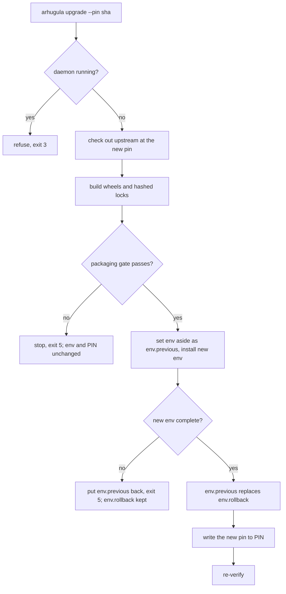

# Upgrade to another upstream commit

This page is for the operator who moves a deployment to another commit of the upstream harness, and for the reviewer who checks what that move changes.
After reading it you can read upstream's changes before you move, run the upgrade, read what it re-verifies, and return to the earlier environment.
For day-to-day commands, read [operate](operate.md). For a message that an upgrade printed, read [troubleshooting](troubleshooting.md).

## Contents

- [What the pin is](#what-the-pin-is)
- [Read upstream's changes before you upgrade](#read-upstreams-changes-before-you-upgrade)
- [Stop the daemons and back up the state](#stop-the-daemons-and-back-up-the-state)
- [Run the upgrade](#run-the-upgrade)
- [What the upgrade does, in order](#what-the-upgrade-does-in-order)
- [What the re-verify runs](#what-the-re-verify-runs)
- [Rebuild at the same pin](#rebuild-at-the-same-pin)
- [Roll back to the earlier environment](#roll-back-to-the-earlier-environment)
- [Sources](#sources)

## What the pin is

The harness is the upstream repository `thestoryportal/arhugula-harness`. A deployment runs exactly one commit of it. That commit is the pin.

The pin is stored in the file `<home>/kit/PIN`, as a full 40-character commit id. See it with:

<!-- witness -->
```sh
cat <home>/kit/PIN
```

```text
2e1ba1f764be27601441936692da2b6c30d61f7c
```

`arhugula --version` prints the kit's version and the same commit, read from `PIN`:

```text
arhugula kit 0.1.0; upstream pin 2e1ba1f764be27601441936692da2b6c30d61f7c
```

The environment keeps its own record of the commit it was built from, in `<home>/env/.arhugula-pin`. `arhugula upgrade` compares the commit you ask for with that record, not with `PIN`.

Three places follow the pin:

| Place | What it holds |
| --- | --- |
| `<home>/upstream` | The harness source, checked out at the pin. |
| `<home>/dist` | The seven wheels built from that source, and two hashed lock files. |
| `<home>/env` | The harness's private Python environment, installed from those wheels. |

The kit's generated configs and its feature fragments were written against the commit in `PIN`. Another commit can change the shape of the config. So read upstream's changes first.

## Read upstream's changes before you upgrade

Upstream ships no changelog file. Read its commits instead. A config-shape change is a new required setting, a renamed key or a removed key in the runtime config.

1. Fetch upstream's new commits. This changes no checked-out file:

   ```sh
   git -C <home>/upstream fetch origin
   ```

2. List the commits between the current pin and the new one that touch the config template, the documents or the examples:

   ```sh
   git -C <home>/upstream log --oneline <current-pin>..<new-pin> -- harness.toml.example docs examples
   ```

3. Read what changed in the config template:

   ```sh
   git -C <home>/upstream diff <current-pin> <new-pin> -- harness.toml.example
   ```

| What you find | What it means for the upgrade |
| --- | --- |
| No change to `harness.toml.example` | The config shape is probably the same. Upgrade. |
| A new optional key | Upgrade. Set the key later with `arhugula config set`, if you want it. |
| A new required key, a renamed key or a removed key | The kit may generate a config that the new runtime refuses. The upgrade finds out for you: see [What the re-verify runs](#what-the-re-verify-runs). Be ready to roll back. |

You do not have to decide from the diff alone. The upgrade has the new runtime's own loader read every generated config, and it tells you when one is refused.

## Stop the daemons and back up the state

An upgrade replaces the environment that a daemon runs from. So it refuses while a daemon runs:

```text
arhugula: a harness daemon is running (pid <pid>); stop it before you upgrade
  fix: arhugula daemon stop
```

1. See which daemons run:

   ```sh
   arhugula daemon status
   ```

2. Stop each one:

   ```sh
   arhugula daemon stop --project <project>
   ```

3. Answer the gates on hold:

   ```sh
   arhugula gate list
   ```

   An upgrade and a rollback do not touch `<home>/state`, where the pause journals are.
   Resuming a gate that was put on hold under another upstream commit was not witnessed.

4. Back up the state root. An upgrade does not touch `<home>/state`, and a backup costs little:

   ```sh
   arhugula state backup
   ```

The observability stack and the virtual machine can stay up.

## Run the upgrade

```sh
arhugula upgrade --pin <sha>
```

`<sha>` is the full 40-character id of a commit on upstream's `main`. A shorter id is refused with exit code 2.
Without `--pin`, the upgrade moves to the commit in `<home>/kit/PIN`.

An upgrade and its re-verify ran on the development machine (*witnessed*). The install prints one line per stage.
The `verify` stage proves what the install put in the environment: see [what the upgrade does](#what-the-upgrade-does-in-order).

```text
install: upstream at 2e1ba1f7
install: build wheels
install: export hashed locks
install: packaging gate
install: environment
install: verify
install: installed 2e1ba1f7 at <home>/env
```

The re-verify ends with the smoke runs:

```text
Smoke runs:
  primary route (claude_code): exit 0, status: completed
  Ollama route: exit 0, status: completed
  project demo: exit 0, status: completed

The deployment is ready.
```

## What the upgrade does, in order

The environment in use stays in place until the new build has passed upstream's packaging gate. The diagram shows where a failure leaves you.



In words: the upgrade refuses while a daemon runs. It then builds the new commit beside the environment in use. Only a build that passes the packaging gate replaces the environment.

The environment in use is set aside while the new one is made, and it comes back when the new one fails or the install is interrupted. When the new one has passed its checks, the earlier environment becomes the rollback copy. The `PIN` file changes last, and then the re-verify runs.

| Step | What happens | If it fails |
| --- | --- | --- |
| 1 | The kit checks that no daemon runs and that `<sha>` is a full commit id. | Exit 3 or 2. Nothing has changed. |
| 2 | `<home>/upstream` is checked out at the new commit. The network is used only when the checkout does not hold that commit yet. | The environment and `PIN` are unchanged. |
| 3 | The seven wheels and the two hashed lock files are built into `<home>/dist`. | The environment and `PIN` are unchanged. |
| 4 | Upstream's packaging gate checks the build. It must print `ready: yes`. | The environment and `PIN` are unchanged. |
| 5 | The environment in use is set aside at `<home>/env.previous`. A new environment is created at `<home>/env` and installed from the hashed locks and the wheels. The wheels are installed without the package cache, because every harness wheel carries the version `0.0.0` and the cache cannot tell one commit's build from another's. | The environment in use is moved back to `<home>/env`. The copy at `<home>/env.rollback` is untouched. |
| 6 | The new environment is checked: it imports the harness from its own files, every installed harness file has the hash of the wheel just built, and its three commands exist. Then it records its commit in `<home>/env/.arhugula-pin`. Last, the environment that was set aside replaces the copy at `<home>/env.rollback`. | The environment in use is moved back to `<home>/env`. The copy at `<home>/env.rollback` is untouched. |
| 7 | The kit writes the new commit id to `<home>/kit/PIN`. | |
| 8 | The re-verify runs. See the next section. | The new environment stays. Roll back if you need to. |

A failure in steps 2 to 6 ends with this message and exit code 5:

```text
arhugula: the install of <new-pin> stopped (exit <code>); its message is above. The deployment is unchanged at <current-pin>
  fix: logs are under <home>/logs
```

The message shows each commit by its first eight characters.

Know these facts about a failed install:

- **The environment and `PIN` are unchanged.** Runs work as before. If you updated the kit first, `PIN` already names the new commit, and the environment is still the earlier one.
- **The source and the wheels may be ahead.** `<home>/upstream` may already be at the new commit. Step 3 empties `<home>/dist` before it builds, so `<home>/dist` may hold the new wheels or an incomplete build. The environment in use does not read either place. The next upgrade or `arhugula upgrade --reinstall` brings them back in step.
- **Only one earlier environment is kept.** Each successful upgrade replaces `<home>/env.rollback`.
- **A failed install keeps the rollback copy.** The install replaces `<home>/env.rollback` only after the new environment has passed its checks. After install exit code 76, 77 or 78, that copy still holds the environment that the last successful upgrade replaced.
- **An interrupted install puts the environment back.** When you press Ctrl-C in step 5 or 6, or the terminal closes, the install moves the environment in use back to `<home>/env`. It prints `install: interrupted` and exits with code 130.
- **A killed install can leave the environment set aside.** A power loss or a forced kill in step 5 or 6 gives the install no chance to put the environment back. Then the environment you had is at `<home>/env.previous`, and `arhugula` may not start. Put it back by hand before you run another upgrade, because the next install removes a leftover `<home>/env.previous`:

  ```sh
  rm -rf <home>/env
  mv <home>/env.previous <home>/env
  ```

The install's own exit code is in the message. It tells you which stage stopped:

| Install exit code | Stage that stopped | Log under `<home>/logs` |
| --- | --- | --- |
| 66, 67 | `git` or `uv` is not on `PATH`, or `<home>/logs` cannot be created. Nothing has changed. | |
| 70, 71 | Fetching upstream, or the commit is not in upstream's repository. | |
| 72 | `<home>/upstream` has local changes to tracked files. The install builds a clean pin only. | |
| 73 | Building the wheels. | `install-build.log` |
| 74 | Exporting the hashed locks. | `install-export.log` |
| 75 | Upstream's packaging gate refused the build. | `install-gate.log` |
| 76, 77 | Setting the environment in use aside, or creating or filling the new environment. | `install-env.log` |
| 78 | Checking the new environment. Either it does not import the harness from its own files, or a file is missing, or it does not hold the wheels just built. In the last case the message is `the environment does not hold the harness wheels just built in <home>/dist`, and the lines above it name up to five installed files that differ. The earlier environment is put back. | `install-env.log` |
| 130 | The install was interrupted in step 5 or 6. The environment in use is back in place. | |

## What the re-verify runs

After the install, the upgrade hands over to `<home>/kit/init --reverify`. That keeps your stored answers, asks nothing, and checks everything again:

1. **The dependencies and the machine preflight checks.** These are the same checks as in `arhugula doctor`.
2. **The install check.** The environment is already at the new pin, so this prints `nothing to do`. Check P9 then tests the filesystem of the state root.
3. **Every config, generated again.** The kit renders the deployment's config and each attached project's config from your answers. The new runtime's own loader must accept every one before any file is put in place.
4. **The state root.** The runtime verifies `<home>/state`, and the kit writes the installation-state document for the new environment.
5. **Preflight checks P11, P12 and P18.** They load each generated config once more, look for leftover placeholders, and resolve the pause-journal directory.
6. **The observability stack**, when the tier is on, and **isolation tier 3**, when it is on.
7. **The smoke runs**, when your answers ask for them: the default provider, Ollama when it is selected, and the current project.

So every project's config is re-validated by the runtime's loader at every upgrade. You do not run a separate command for it.

### When the new runtime refuses a config

If upstream changed the config shape, step 3 stops with exit code 4:

```text
arhugula: the runtime refuses the new config for <project> (RT-FAIL-CLI-CONFIG-LOAD): <the loader's message>
Nothing was changed.
```

The configs in place are still the earlier ones, and the environment is already the new one. Do this:

1. Read the loader's message. It names the field that upstream changed.
2. Roll back: `arhugula upgrade --rollback`. The deployment then runs the earlier commit again.
3. Stay on the earlier commit until the kit supports the new config shape. Tell the kit's maintainers which field the loader named.

## Rebuild at the same pin

```sh
arhugula upgrade --reinstall
```

`--reinstall` builds the environment again at the commit in `PIN`, even when the environment is already at that commit. It follows the same steps as an upgrade. It also moves the environment it replaces to `<home>/env.rollback`, in place of the copy that was there.

Use it when the environment is damaged. For example, a file under `<home>/env` was changed or removed. After that rebuild, `<home>/env.rollback` holds the damaged environment, so do not roll back to it.

Use it once if an earlier kit version upgraded your deployment.
That version installed the wheels through the package cache, so an upgrade could rebuild the wheels and still install the earlier commit's files (*witnessed*).
The installer now checks the installed files against the wheels, and `arhugula upgrade --reinstall` replaces the environment with one that passed that check.

The same holds after `arhugula relocate`, which rebuilds the environment in the same way.
`<home>/env.rollback` then holds the environment that was built for the earlier home, and its scripts carry that path.
A rollback to it was not tried.

You do not need `--reinstall` after you update the kit. When a `git pull` in `<home>/kit` changes `PIN`, plain `arhugula upgrade` reads the new `PIN`, finds that the environment records another commit, and upgrades to the new one.

Without `--pin` and without `--reinstall`, `arhugula upgrade` changes nothing when the environment is already at the commit in `PIN`. It prints that the deployment is already at that commit and exits 0. It still refuses with exit code 3 while a daemon runs.

## Roll back to the earlier environment

```sh
arhugula upgrade --rollback
```

The rollback needs no network and no build:

1. It refuses while a daemon runs, as an upgrade does.
2. It swaps `<home>/env` and `<home>/env.rollback`. So the environment you leave is kept, and a second `--rollback` returns to it.
3. It writes the earlier commit id back to `<home>/kit/PIN`. To move forward again later, name the commit: `arhugula upgrade --pin <sha>`.
4. It runs the same re-verify as an upgrade. That checks `<home>/upstream` out at the earlier commit and generates every config again.

If no complete earlier environment exists, the rollback refuses with exit code 3 and changes nothing:

```text
arhugula: there is no complete earlier environment at <home>/env.rollback to return to
  fix: arhugula upgrade --pin <sha> installs any commit again
```

An earlier environment is complete when it holds its commit record, `.arhugula-pin`. A deployment that has never finished an upgrade or a rebuild has none, because the first install replaces nothing.

After a rollback, `<home>/dist` still holds the wheels of the last build. The next upgrade or `--reinstall` replaces them.

When the rollback or the upgrade has finished, check the deployment with `arhugula doctor` and start the daemons again with `arhugula daemon start`.

## Sources

Kit modules, under `<home>/kit`:

- `PIN`: the pinned commit.
- `bin/install.sh`: the build, the packaging gate, the environment swap, the install exit codes.
- `lib/arhugula_kit/verbs_lifecycle.py`: `_upgrade`, the daemon refusal, the rollback.
- `lib/arhugula_kit/initflow.py`: what `init --reverify` runs.
- `lib/arhugula_kit/deploy.py`: how every config is loaded by the runtime before it is put in place.
- `lib/arhugula_kit/preflight.py`: checks P11, P12 and P18.

Upstream documents, under `<home>/upstream`:

- `harness.toml.example`: the config template to compare between two commits.
- `docs/how-to-deploy.md`: upstream's own install from wheels.
- `tools/q4_packaging_gate.py`: the packaging gate that the install runs.
