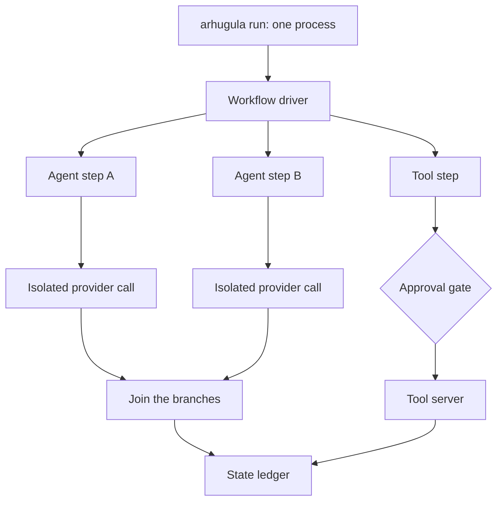

# Write and run workflows

This page is for the workflow author, human or agent.
After reading it, you can read a manifest field by field, choose a topology, create a manifest, check it and run it.

A *workflow* is a set of steps that the harness runs for you.
A *manifest* is the file that describes one workflow, written in Tom's Obvious Minimal Language (TOML).
The commands on this page use a project: attach one first, as the [projects page](projects.md) shows.
The runs use Ollama and the model `llama3.2:3b`: see [the dependencies](install.md#dependencies).

## On this page

- [How a workflow runs](#how-a-workflow-runs)
- [Read a manifest field by field](#read-a-manifest-field-by-field)
- [Choose one of the six topologies](#choose-one-of-the-six-topologies)
- [Pass one step's output to the next](#pass-one-steps-output-to-the-next)
- [Create a manifest](#create-a-manifest)
- [Check a manifest](#check-a-manifest)
- [Run a manifest](#run-a-manifest)
- [Give agents tools](#give-agents-tools)
- [Put an approval gate in a workflow](#put-an-approval-gate-in-a-workflow)
- [Run the gated example](#run-the-gated-example)
- [Upstream limit: a lead does not direct its workers](#upstream-limit-a-lead-does-not-direct-its-workers)
- [Sources](#sources)

## How a workflow runs

One command starts one process, and that process runs the whole workflow.
That is the multi-agent execution model:

- **One process runs everything.** `arhugula run` starts the runtime once. The runtime's workflow driver runs every step, in the order the topology sets.
- **Branches run at the same time.** Parallel branches, an orchestrator's workers and a hierarchy's children run concurrently inside that one process.
- **Each agent step is one isolated provider call.** The call is short-lived, and a command-line provider gets no session and a scrubbed environment. Claude Code and Codex also get no tools of their own. Antigravity starts in the project's repository, and no flag switches its tools off: see [What each call can see](providers.md#what-each-call-can-see). The [providers page](providers.md#how-the-runtime-calls-a-command-line-provider) shows the exact command lines.
- **No terminal multiplexer is involved.** The harness opens no panes and no windows. You watch one command in one terminal.
- **A reviewer is a role in a topology.** The evaluator of an evaluator-optimizer workflow reviews the generator. The synthesis step of an orchestrator-workers workflow combines the workers. To review with another model, route that step: see [Review with a second model](providers.md#review-with-a-second-model).

An agent step changes nothing in the world by itself, with two exceptions:

- **Antigravity.** A step that Antigravity serves runs in the project's repository. The runtime passes no flag that switches its tools off, and no gate would cover them (*upstream limit*). Whether it uses them is not established.
- **A custom agent.** A step on a custom provider whose command is an agent with its own tools can act. The harness sees only its reply: see [Run an agent that acts with its own tools](providers.md#run-an-agent-that-acts-with-its-own-tools).

Every other step acts only through the harness.
A tool step calls a tool server.
On some providers, a model can call the tools of a connected server.
An approval gate can stand in front of a call.
[Give agents tools](#give-agents-tools) says which.



The diagram shows one run.
The command starts one process, and its workflow driver starts two agent steps at the same time.
Each agent step makes its own isolated provider call, and the driver joins the two results.
A tool step passes an approval gate before it reaches its tool server.
Every step's result ends in the project's state ledger, whichever provider served it.

A run on a subscription provider writes no cost entry and no audit entry: see [Know what a run costs](providers.md#know-what-a-run-costs).

## Read a manifest field by field

A manifest has four parts: a version line, a `[workflow]` table, a `[default_model_binding]` table and one `[[steps]]` entry for each step.
This is the smallest upstream example, `ollama-first.toml`, without its comments:

```toml
version = 1

[workflow]
workflow_id = "example-ollama-first"
workload_class = "pipeline-automation"
persona_tier = "solo-developer"
engine_class = "pure-pattern-no-engine"
topology_pattern = "single-threaded-linear"
layer_budgets = []
hitl_placements = []
per_step_overrides = {}
fallback_chain = { primary = { provider = "ollama", model = "llama3.2:3b", family = "local_open_weight" }, same_family = [], cross_family = [] }

[default_model_binding]
provider = "ollama"
model = "llama3.2:3b"

[[steps]]
step_id = "ask-local-model"
step_kind = "inference-step"

[steps.step_payload]
messages = [{ role = "user", content = "Reply with the single word: OK" }]
tools = []
params = { options = { num_predict = 8 } }
```

The loader refuses a field it does not know, so keep the field names exactly.

### The version line

`version = 1` is the manifest format.
It is the only version the loader accepts.

### The `[workflow]` table

| Field | Meaning | Values |
| --- | --- | --- |
| `workflow_id` | The workflow's name. A run reports it, and a paused run is resumed by it. | any text |
| `workload_class` | The kind of work. The project's config must bind this class. | `pipeline-automation`, `software-engineering`, `research`, `content-creation` |
| `persona_tier` | Who operates the workflow. It sets the floor for approval gates, and the [auto-approve policy](security-and-isolation.md#set-what-a-gate-approves-without-asking) applies only at `solo-developer`. It is separate from the deployment's `persona_tier` setting, which decides trace sampling, trace redaction and prompt-version approval, and which a gate on a model's tool call reads; the runtime does not compare the two. | `solo-developer`, `team-binding`, `multi-tenant-compliance` |
| `engine_class` | How the run is executed. Every upstream example uses `pure-pattern-no-engine`, which runs the steps inline. | `pure-pattern-no-engine`, `event-sourced-replay`, `save-point-checkpoint`, `reconciler-loop`, `WAL-segment` |
| `topology_pattern` | How the steps relate. | the six in [Choose one of the six topologies](#choose-one-of-the-six-topologies) |
| `layer_budgets` | Time budgets for the routing layers. Every upstream example leaves the list empty. | a list |
| `hitl_placements` | The approval gates of the workflow's tool steps. They do not cover a tool call that a model decides on. | a list; see [Put an approval gate in a workflow](#put-an-approval-gate-in-a-workflow) |
| `per_step_overrides` | Settings for single steps, keyed by step id. | a table; see below |
| `fallback_chain` | A provider chain written in the manifest. It is a label: it does not choose the provider. | `primary`, `same_family`, `cross_family` |
| `worker_selection` | Who chooses an orchestrator's workers. Optional. | `declared-pool` (the default), `lead-plan` |

The routing rule decides which provider serves a step.
The config's first fallback chain serves every step; `--provider` (and `--model`) override it for one run; a manifest's own model binding does not select the provider.
A more specific setting wins over the chain: a per-step `model_binding`, described below, a workload override or a role binding.
The [providers page](providers.md#how-routing-picks-a-provider) explains the rule and that order.

To choose a model for one step or sub-agent, write its `model_binding` here.
Other places exist: [Choose a model and a thinking level](providers.md#choose-a-model-and-a-thinking-level) lists them with the exact command or manifest line.

`arhugula workflow validate` prints each step's binding and a note when its provider is not enabled.

The loader accepts five more optional fields in this table: `entry_version`, `default_gate_level`, `fanout_timeout_disposition`, `concurrent_cache_warmup` and `sub_agent_briefs`.
No upstream example sets them.

### The `per_step_overrides` table

Each entry is keyed by a step id and repeats that id in `step_id`.
All other fields are optional.

| Field | What it overrides for that step |
| --- | --- |
| `model_binding` | the provider and model, as `{ provider = "...", model = "..." }` |
| `agent_role` | the role the step runs under |
| `prompt_version_sha` | the prompt version that the step receives |
| `engine_class` | the engine class |
| `hitl_placement` | an approval gate for the step |
| `removed_placements` | approval gates that the step drops; only `sub-agent-boundary` can be dropped |

A `model_binding` here is the one manifest setting that does select a provider.

The example `examples/workflows/two-agents.toml` binds step one to `claude_code` with `haiku@low` and step two to `codex` with `gpt-6.1-sol@medium`.
A run of it completed, and its two model-call spans named exactly those models (*witnessed*).
[Choose a model and a thinking level](providers.md#choose-a-model-and-a-thinking-level) shows how to make the models available first.

### The `[default_model_binding]` table

It holds a `provider` and a `model`.
Like `fallback_chain`, it does not choose the provider.
One run flag reads it: `--model` alone keeps this provider.

### The `[[steps]]` entries

Each step has three fields.

| Field | Meaning |
| --- | --- |
| `step_id` | The step's name. It must be unique in the manifest. |
| `step_kind` | What the step does. |
| `step_payload` | The step's input. Its shape depends on the step kind. |

The examples on this page use four of the seven step kinds.

| Step kind | What it does | Payload |
| --- | --- | --- |
| `inference-step` | Sends messages to a model. On `ollama` and `anthropic`, the model can call tools: see [Give agents tools](#give-agents-tools). | `messages`, `tools`, `params` |
| `tool-step` | Calls one named tool of a connected tool server, with fixed arguments. | `tool_id`, `tool_args` |
| `sub-agent-dispatch` | Runs a child workflow. | `child_workflow_id`, `child_manifest_entry`, `child_steps`, `brief` |
| `post-join-synthesis` | Combines the outputs of the branches after they join. It takes no tools. | `messages`, `params` |

The loader also knows `declarative-step`, `HITL-step` and `managed-agents`.
No upstream example uses them.

In an inference step, `params` has the shape that the provider reads.
Ollama reads `options.num_predict` for the reply length; the other providers read `max_tokens`.
Every inference step needs a `params` table, even an empty one (`params = {}`).
Without it the workflow loads and `workflow validate` passes, but the run fails with `RT-FAIL-PAYLOAD-SHAPE ... params Field required` (*witnessed*).

## Choose one of the six topologies

A *topology* is the pattern that relates the steps.
Upstream ships one example for each topology.
List them, together with the manifests of your project:

<!-- witness -->
```sh
arhugula workflow list
```

Output from a deployment with no project manifests:

```text
where              file                                 workflow id                             topology                 notes
upstream examples  minimal.toml                         example-minimal                         single-threaded-linear   1 steps, pipeline-automation
upstream examples  ollama-decentralized-handoff.toml    example-ollama-decentralized-handoff    decentralized-handoff    3 steps, pipeline-automation
upstream examples  ollama-evaluator-optimizer.toml      example-ollama-evaluator-optimizer      evaluator-optimizer      2 steps, content-creation
upstream examples  ollama-first.toml                    example-ollama-first                    single-threaded-linear   1 steps, pipeline-automation
upstream examples  ollama-hierarchical-delegation.toml  example-ollama-hierarchical-delegation  hierarchical-delegation  4 steps, research
upstream examples  ollama-orchestrator-workers.toml     example-ollama-orchestrator-workers     orchestrator-workers     4 steps, research
upstream examples  ollama-parallelization.toml          example-ollama-parallelization          parallelization          2 steps, research
```

| Topology | Upstream example | What the example shows |
| --- | --- | --- |
| `single-threaded-linear` | `ollama-first.toml` | One inference step. Steps run one after another. |
| `decentralized-handoff` | `ollama-decentralized-handoff.toml` | Three stages: draft, review, finalize. One stage owns the work at a time, and each stage acts on the output of the stage before it. |
| `parallelization` | `ollama-parallelization.toml` | Two peer branches. They run at the same time, the driver joins them, and it folds the results in branch order. |
| `orchestrator-workers` | `ollama-orchestrator-workers.toml` | A lead step runs first. Two workers then run at the same time. A synthesis step receives the worker outputs and writes the result. |
| `hierarchical-delegation` | `ollama-hierarchical-delegation.toml` | Orchestrator-workers, applied twice. The root lead has a direct worker and a child workflow with its own lead and two workers. A parent has at most three direct children; a fourth is refused. |
| `evaluator-optimizer` | `ollama-evaluator-optimizer.toml` | A generator writes a tagline and an evaluator judges it. The driver repeats both until the evaluator accepts or three rounds have run. |

Before you copy one of these examples, note three things.

- **The handoff and the evaluator examples need data flow.** Without it, a later step never sees the earlier output: see [Pass one step's output to the next](#pass-one-steps-output-to-the-next).
- **The evaluator must reply with one exact object.** The reply is `{"accepted": true or false, "feedback": "..."}` and nothing else. Any other reply fails the run.
- **`completed` does not mean accepted.** An evaluator-optimizer run that reaches three rounds still ends `completed`. The text output does not show the verdict; `--json` prints the full result.

`minimal.toml` is a seventh file, not a seventh topology.
It is a single step that names the hosted Anthropic model.

## Pass one step's output to the next

By default, a step does not receive the output of the step before it.
The feature `data-flow` changes that: each step then receives the most recently recorded step output.

Read what the feature does and whether it is on:

```sh
arhugula feature show data-flow
```

```text
data-flow: Inter-step data flow
state:  off
needs:  nothing

Each step receives the most recently recorded step output. Handoff and evaluator-optimizer workflows need it; peer branches of a parallel workflow are not meant to consume it.

It merges this into every generated config:

[runtime]
inter_step_data_flow = true
```

Switch it on for every config of the deployment:

```sh
arhugula feature enable data-flow
```

| Topology | Do you need `data-flow`? |
| --- | --- |
| `decentralized-handoff` | Yes. Each stage works on the output of the stage before it. |
| `evaluator-optimizer` | Yes. The evaluator must see the draft, and the generator must see the feedback. |
| `parallelization` | No. Peer branches are not meant to read each other. |
| `orchestrator-workers`, `hierarchical-delegation` | No. The synthesis step receives the worker outputs without it. |
| `single-threaded-linear` | Only when a later step must read an earlier one. |

## Create a manifest

`arhugula workflow new` writes a starting manifest for a topology (*kit extension*).
It derives the manifest from the upstream example for that topology, so the file has the shape that your installed runtime loads.

<!-- witness -->
```sh
arhugula workflow new parallelization --name fanout --project <project>
```

The command writes `<project-path>/workflows/fanout.toml` and checks that it loads.
It then prints the topology, the number of steps and the workload class.

The command makes three changes to the upstream example:

- **It sets the workflow id.** The id is the `--name` you gave.
- **It rewrites the bindings.** Every provider and model in the file becomes your deployment's default provider and its model.
- **It reshapes the step parameters.** For a default provider other than Ollama, `options.num_predict` becomes `max_tokens`.

Then edit the steps and their messages, and keep the field names.

| Option | What it does |
| --- | --- |
| `--name <name>` | Sets the workflow id and the file name. Required. |
| `--project <project>` | Chooses the project. Without it, the command uses the current project. |
| `--output <file>` | Writes to that file, not to the project's `workflows/` directory. |

The command refuses, with exit code 3, when the file already exists.
It also refuses when no project is current and you gave no `--output`.

## Check a manifest

`arhugula workflow validate` loads a manifest through the runtime's own loader.
It calls no provider, so it costs nothing and you can run it after every edit.

<!-- witness -->
```sh
arhugula workflow validate fanout.toml --project <project>
```

```text
<project-path>/workflows/fanout.toml loads.
  workflow id:   fanout
  topology:      parallelization
  workload:      research
  step:          branch-overview (inference-step)
  step:          branch-risks (inference-step)
```

When the manifest does not load, the command exits with code 4 and prints the loader's reason.
This is the message for a topology name that does not exist:

```text
arhugula: <file> does not load (RT-FAIL-CLI-MANIFEST-ENUM-VALUE): invalid enum value at 'workflow.topology_pattern': Input should be 'single-threaded-linear', 'orchestrator-workers', 'decentralized-handoff', 'hierarchical-delegation', 'evaluator-optimizer' or 'parallelization'
```

The command also prints a warning when the project does not bind the manifest's workload class.
Such a run would fail when it starts.

## Run a manifest

Run the manifest you created, on Ollama:

<!-- witness -->
```sh
arhugula run fanout.toml --project <project> --provider ollama
```

A run prints an `override:` line when you pass `--provider` or `--model`, then its progress, then three result lines:

```text
status:    completed
workflow:  fanout
ledger:    <64-character hash>
```

`arhugula workflow run` is the same command as `arhugula run`.

| Flag | What it does |
| --- | --- |
| `--project <project>` | Chooses the project. Without it, the run uses the current project. |
| `--provider <provider>` | Sends every step of this run to this enabled provider first, with the model that your deployment configured for it. |
| `--model <model>` | Sends every step of this run to this model. With `--provider`, it overrides that provider's configured model. |
| `--json` | Prints the full result as JSON, with each step's reply. Text mode does not print replies. |
| `--daemon` | Sends the run to the running daemon. |

The `override:` line names the provider and the model that every step goes to first.
For this run it names `ollama/llama3.2:3b`, the model configured for Ollama, whatever model the manifest holds.

A provider that fails still falls back along the config's chain.
So `status: completed` does not prove that Ollama served the run.

The run's progress output is also written to a log file in `<home>/logs/`.
Read the newest one with `arhugula logs`.

## Give agents tools

This section is for the workflow author and the operator.
After reading it you can choose which steps use tools, connect a tool server, and know which tools a model can reach.
A *tool* is an action that a tool server offers, such as reading a note.
The runtime reaches tool servers through the Model Context Protocol (MCP).

Two other pages complete the account.
[Set what a gate approves without asking](security-and-isolation.md#set-what-a-gate-approves-without-asking) says who approves a tool call.
[Run an agent that acts with its own tools](providers.md#run-an-agent-that-acts-with-its-own-tools) says how to use a subscription agent that edits files or runs commands.

### Choose how a step uses a tool

A step reaches a tool in one of two ways.

- **A tool step names the tool.** It calls exactly one named tool with fixed arguments, and no model decides anything. The trace of such a step holds a tool call and no model call (*witnessed*).
- **An inference step lets the model decide.** The runtime offers the model its tools, and the model chooses whether to call them. Whether the call runs depends on the provider that serves the step.

This table says what happens to the tool calls of a model:

| Provider | What happens to a model's tool calls | Basis |
| --- | --- | --- |
| `ollama` | They run. One step can make up to 16 rounds of calls. | *Witnessed*: the model called a tool in 6 of 6 runs |
| `anthropic` | They run, for up to 16 turns in one step, when the step's `tools` field holds a list, even an empty one. A 17th turn is an error. | Read in the code, not run |
| `openai` | The model is offered the tools, but its calls are not run. They come back as the step's result. | Read in the code, not run |
| `claude_code`, `codex`, `antigravity` and a custom provider | These providers take and return text only. A step that lists tools is refused before the call. | Read in the code, not run |

On `openai`, only the memory tools run: a separate loop serves them, and a batch that mixes memory calls with other calls is handed back unrun.

The refusal by a text-only provider is immediate, so the fallback chain does not fail the step but serves it with the next provider.
A run can therefore end `status: completed` on a provider that you did not choose.
To see which provider served, read the provider on the run's model-call span.
A run with `--provider` also prints a `served by` line when its provider failed: see [How routing picks a provider](providers.md#how-routing-picks-a-provider).
A step with `tools = []` passes the check, and the provider gets text only.

Other step kinds treat tools in these ways:

- **A `declarative-step` calls nothing.** It returns its `payload.output`.
- **A `post-join-synthesis` step takes no tools.** The runtime rejects a tool binding on it.
- **A `sub-agent-dispatch` step runs a child workflow.** The steps of the child use tools on the same terms. A child inference step is not offered a tool that its server declares `EXTERNAL_IRREVERSIBLE`. The gate level of the parent becomes a floor for the child, and a `sub-agent-boundary` placement gates the handoff itself.
- **All six topologies dispatch a step the same way.** A tool is called on the same terms in each of them.

A small model does not always use a tool well.
After a vague prompt, "Read the note and tell me what it says.", the model called `notes.read` and then invented the note's content (*witnessed*).
Name the tool and say what to do with its result in the step's message.

### Know which tools a new deployment has

A new deployment has no general-purpose tool: no file tool, no shell tool, no web tool and no git tool.
On a fresh deployment `arhugula mcp list` prints that no client is configured (*witnessed*).
A model step can reach only the runtime's own memory tools and the tools of the servers that you connect.

- **The memory tools.** They are `memory.search`, `memory.read`, `memory.write_note`, `memory.propose_promotion` and `memory.request_redaction`. A model gets them only when all four of these hold (see [How memory reaches a model](memory.md#how-memory-reaches-a-model)):
  - the memory access mode is `standard_memory_tools`;
  - the runtime has a memory executor;
  - the provider is `openai`, `ollama` or `anthropic`;
  - the provider's model family matches the family of the memory scope, which is the primary family of the fallback chain.

  With `--provider ollama` while the chain's primary was `claude_code`, the families differed and the tools were not offered (*witnessed*): the span read `degraded_serve` with the reason `provider_family_scope_mismatch`.
- **The notes server.** `examples/mcp/notes_server.py` is a demonstration server with two tools. `notes.read` returns its argument, and `notes.write` appends its argument to `notes.txt` beside the server file. Nothing connects it until you run `arhugula mcp add`. [Run the gated example](#run-the-gated-example) uses it.
- **The echo server.** `upstream/deploy/self-hosted-local/mcp_echo_server.py` is a `stdio` server with one tool, `echo(value)`. The client `sandbox-echo` points at it. That client exists only after `arhugula isolation enable tier-3`. It is a `stdio` client with trust level `L1_SIGNED_PINNED` and blast radius `READ_ONLY`, and its tool runs in a container that has no network.
- **One tool that no model sees.** The runtime registers a tool named `search_tools`, but it never offers it to a model.

### Connect a tool server

To connect a server that already exists, give the client a name and the server's address:

```sh
arhugula mcp add <name> --url <url>
```

The command stores the client with trust level `L3_ALLOW_WITH_AUDIT` and blast radius `READ_ONLY`.
Then `arhugula mcp test <name>` lists its tools.
Change those two labels with `--trust` and `--blast-radius`.
[Declare how far you trust an MCP server](security-and-isolation.md#declare-how-far-you-trust-an-mcp-server) says what each label does.
[Know which tool servers run today](#know-which-tool-servers-run-today) says which labels run.

These commands manage clients:

| To do this | Run |
| --- | --- |
| List the clients | `arhugula mcp list` |
| Ask a client for its tools | `arhugula mcp test <name>` |
| Remove a client | `arhugula mcp remove <name>` |

A tool name must be unique across all connected servers.
A name that two servers share stops the runtime at its start, so every run fails until you remove one client.

### Write a tool server

The smallest working server uses the MCP package that the harness environment already holds.
This is the core of `examples/mcp/notes_server.py`, cut to one tool:

```python
import sys

from mcp.server.fastmcp import FastMCP

server = FastMCP("example-notes", host="127.0.0.1", port=int(sys.argv[1]))


@server.tool(name="notes.read")
def read(value: str) -> str:
    """Return the value unchanged."""
    return value


if __name__ == "__main__":
    server.run(transport="streamable-http")
```

The server listens on the loopback address and the port you pass.
You start it yourself, because the kit starts no tool server.
Do these steps in order:

1. **Start the server.** Run it in its own terminal, because it keeps running.

   ```sh
   <home>/env/bin/python <path-to-your-server>.py 18765
   ```

2. **Connect it.**

   ```sh
   arhugula mcp add notes --url http://127.0.0.1:18765/mcp
   ```

3. **Ask it for its tools.**

   ```sh
   arhugula mcp test notes
   ```

The output of steps 2 and 3, from the full example server, was this (*witnessed*):

```text
added MCP client notes (streamable_http_l3, L3_ALLOW_WITH_AUDIT, READ_ONLY).
check it: arhugula mcp test notes
notes answers at http://127.0.0.1:18765/mcp with 2 tool(s):
  notes.read: Return the value unchanged.
  notes.write: Append the value to notes.txt.
```

The client carries the label `READ_ONLY`, because no other label runs on this deployment.
A label is your declaration, so a server whose tool writes is approved like a reading one.
Read [Know which tool servers run today](#know-which-tool-servers-run-today) before you connect a server that changes anything.

### Choose a transport

The option `--transport` takes five values.
There is no value for SSH and none for server-sent events.

| Value | What the runtime does | What it needs |
| --- | --- | --- |
| `streamable_http_l3` (the default), `streamable_http_l1`, `streamable_http_l2`, `streamable_http_l0` | It calls the server over HTTP. The suffix has no effect: the runtime reads the trust level from `--trust` and treats all four as plain streamable HTTP. | A server that listens at the URL. |
| `stdio` | It starts the command that `--url` holds. Write the value as `stdio://<command and arguments>`. The runtime splits it as a shell does. The command gets the MCP package's default environment: `HOME`, `LOGNAME`, `PATH`, `SHELL`, `TERM` and `USER`. | Isolation tier 3 and the virtual machine. The call then goes to a container command, not to this server. See below. |

The runtime's code names a third kind, server-sent events (`sse`), but no configuration can select it.

### Connect a hosted server with a credential

A hosted server over HTTPS usually wants a token.
Name the keychain entry that holds it:

```sh
arhugula mcp add <name> --url https://<host>/mcp --auth-secret-name <entry>
```

The runtime reads the token from the macOS keychain, in the service `harness` under the account `<entry>`.
It sends the token as `Authorization: Bearer <token>`.
The environment is not a fallback for this token: the runtime reads `ANTHROPIC_API_KEY` and `OPENAI_API_KEY` from the environment for the two API providers only.
The flag is refused for a `stdio` client, and for a plain `http` URL that points to a host other than the loopback address.

The kit has two gaps here, and an operator meets both:

- **No verb stores the token.** Create the keychain entry in your own terminal: [Keep secrets out of TOML](configure.md#keep-secrets-out-of-toml) shows the command.
- **`arhugula mcp test` sends no token.** It cannot test a server that needs one. It also refuses a `stdio` client. Test such a server with a workflow that calls one of its tools.

A hosted server must also carry the label `READ_ONLY`, as the table below shows.

### Know why an SSH server does not work

The runtime has no SSH transport.
You can write `ssh <host> <server>` as the command of a `stdio` client, written as `stdio://ssh <host> <server>`.
That does not give you a working server on this deployment, for three reasons:

- **Tier 3 never sends a tool call to the `ssh` command.** A `stdio` client runs at tier 3 or above. At tier 3, the container driver ignores the MCP connection. It runs the command of the client's sandbox driver in a container, with the call as JSON on standard input.
- **No agent key reaches `ssh`.** The environment of a `stdio` command holds no `SSH_AUTH_SOCK`, so a key held by an SSH agent is not available to it.
- **A `stdio` client needs tier 3.** Without a sandbox driver, every run fails at its start: see the next section.

Whether the runtime starts a `stdio` command when it lists tools at its start is not established.

### Know which tool servers run today

Today, a tool server can run only when you label it read-only and reach it over HTTP.
Any other label makes every run fail at its start, including a run that calls no tool.
The runtime builds its sandbox drivers at start, and one client without a driver stops it.
This table shows each case:

| Server | Tier | Does it run today? |
| --- | --- | --- |
| HTTP, trust `L3_ALLOW_WITH_AUDIT` or `L1_SIGNED_PINNED`, `READ_ONLY` | 1, on the host | **Yes.** It calls the real server (*witnessed* at `L3_ALLOW_WITH_AUDIT`). |
| HTTP, `LOCAL_MUTATION` | 2 | **No.** The kit provides no tier 2 driver, and `arhugula isolation attach` refuses a client that is not `stdio`. Every run is refused at its start (*witnessed* at `L3_ALLOW_WITH_AUDIT`). |
| HTTP, `EXTERNAL_REVERSIBLE` or `EXTERNAL_IRREVERSIBLE` | 3 or 4 | **No**, for the same reason. |
| HTTP, trust `L2_SANDBOX_ALL`, any blast radius | 4 | **No.** Tier 4 needs Kata or E2B, and this deployment has neither. |
| HTTP, trust `L0_REFUSE_REMOTE` | none | **No.** The runtime refuses a remote server at this level when you register it. |
| `stdio`, `READ_ONLY` | 3 | **Only with tier 3 enabled.** Then the call goes to the container command that the sandbox driver names, not to the MCP server. |

Tier 3 for a `stdio` client does not run the server's tools.
[Run tool calls in a sandbox](security-and-isolation.md#run-tool-calls-in-a-sandbox) says what it does and does not protect.
So today a tool that changes files, or anything outside the machine, cannot run under an honest label.

The only way to run such a tool is to label its server `READ_ONLY`.
That label is false, and the runtime then approves its calls as it approves a read: see [Set what a gate approves without asking](security-and-isolation.md#set-what-a-gate-approves-without-asking).
The runtime's tier model has no driver that calls a remote server from a sandbox (*upstream limit*), and the kit has no tier 2 driver.
[Known gaps](reference/known-gaps.md#tools-and-permissions) lists each limit.

### Know that a step's `tools` list limits nothing

The `tools` field of an inference step holds tool definitions, not names.
It is not an allow-list.
On `ollama` and `anthropic`, the runtime offers the model every registered tool, whatever the list holds: the memory tools and the tools of every connected server.
A step with `tools = []` still offered `notes.read` to the model, and the model called it (*witnessed*).
On `openai` the runtime sends the list as written and does not run the calls, and on the command-line providers a list that is not empty is refused.

No setting limits a model step to a subset of the registered tools.
To keep every tool away from a step, serve it with a text-only provider and write `tools = []`.
To keep one tool away, do not connect its server.

### Know who approves a tool call

Two cases differ, and the security page explains both.

- **A tool step.** The workflow's `hitl_placements` place the gate, and `tool_filter` narrows it.
- **A tool call that a model decides on.** The runtime reads neither the placements nor the filter. The gate level comes from the persona, the server's declared blast radius and its trust level.

With the default policy, a tool of a server that you label `READ_ONLY` is approved without asking in both cases.
So `examples/workflows/gated-tool.toml` asks nobody until you switch `solo-floor-auto` off (*witnessed*, both ways).

## Put an approval gate in a workflow

An *approval gate* stops a run and asks a person before a step goes on.
Upstream calls this human-in-the-loop (HITL).
You declare gates in the manifest's `hitl_placements` list.

These placements decide the gates of tool steps.
They do not decide the approval of a tool call that a model chooses to make: for those calls the runtime reads no placement.
[Set what a gate approves without asking](security-and-isolation.md#set-what-a-gate-approves-without-asking) explains both cases.

Each placement names a position.
There are three positions.

| Position | Where the gate stands |
| --- | --- |
| `pre-action` | before a tool call |
| `sub-agent-boundary` | at the handoff from a parent to a child workflow |
| `validator-escalation` | after a validator has failed and the retries are used up |

A placement has up to four fields.

| Field | Meaning |
| --- | --- |
| `position` | one of the three positions; required |
| `tool_filter` | for `pre-action`: the exact tool names that the gate covers; patterns and an empty list are refused. A filtered placement matches only a tool step whose `tool_id` is listed, never an inference step. A `pre-action` placement with no filter matches every action, inference steps included |
| `cascade_policy` | replaces the workload class's default cascade policy: `pause`, `proceed` or `cascade-cancel` |
| `timeout` | how long the gate waits for an answer, in milliseconds; without it, the gate waits 900 seconds. The kit sets the step deadline to 960 seconds and the run limit to 3600 seconds, so a gate can wait its full 900 seconds unless you lowered them: see [the capability matrix](configure.md#capability-matrix) |

A step that no placement matches has no gate at all.
A gate does not always ask, either.
The deployment's policy lets some calls pass without asking; see it with `arhugula policy show`:

```text
What an approval gate approves without asking (solo-developer persona):
  solo-floor-auto:            on   read-only tool calls at the solo floor
  local-mutation-floor-auto:  off  tool calls that change local files

With a setting off, the gate asks you in the terminal. A run without a terminal rejects the gate.
```

## Run the gated example

The kit ships a workflow with a gate, `examples/workflows/gated-tool.toml`, and a small tool server for it (*kit extension*).
The workflow has two tool steps.
A `pre-action` placement puts a gate in front of the tool `notes.write`; the tool `notes.read` has no gate.
With the default policy, this gate asks nobody: it approves the call by itself, and `notes.write` writes its file (*witnessed*).
Step 4 below switches the policy so that the gate asks.

The server speaks the Model Context Protocol (MCP), which is how the runtime reaches tools.
Its two tools are `notes.read`, which returns its argument, and `notes.write`, which appends its argument to a file beside the server.

Do these steps in order.

1. **Start the tool server.** Run it in a second terminal and leave it running. It listens on the loopback port you give.

   ```sh
   <home>/env/bin/python <home>/kit/examples/mcp/notes_server.py 18765
   ```

2. **Connect the server.** Give the client any name; this example uses `notes` and leaves `--blast-radius` at its default, `READ_ONLY`, although `notes.write` appends to a file (*witnessed*). It does so because this deployment refuses every run while a URL client is declared `LOCAL_MUTATION`: see [known gaps](reference/known-gaps.md#platform-and-provider-limits). So the gate asks only because step 4 switches the policy off. A label is your declaration and nothing checks it: read [Declare how far you trust an MCP server](security-and-isolation.md#declare-how-far-you-trust-an-mcp-server) first.

   ```sh
   arhugula mcp add notes --url http://127.0.0.1:18765/mcp
   ```

3. **Check the connection.** The command lists the two tools.

   ```sh
   arhugula mcp test notes
   ```

4. **Make the gate ask.** With this setting off, the gate asks you in the terminal.

   ```sh
   arhugula policy set solo-floor-auto off
   ```

5. **Run the workflow.** Run it in a terminal, because a run without a terminal rejects the gate.

   ```sh
   arhugula run <home>/kit/examples/workflows/gated-tool.toml
   ```

6. **Answer the gate.** The run stops at the first step and shows the call it is about to make. Type `approve` within 15 minutes: the gate waits 900 seconds, and the kit's step deadline is 960 seconds. After the step deadline the run fails with `RT-FAIL-STEP-DISPATCH-TIMEOUT`; [the capability matrix](configure.md#capability-matrix) shows how to change the deadline.

The prompt and the result of an approved run (*witnessed*), with the progress lines left out:

```text
HITL gate at pre-action
step: write-note (tool-step)
payload sha256: 87d1662069040e6133d8bd1e3f900cbb3d965a791268bbf896f2191d2e5538e8
payload: {"tool_args":{"value":"approved by a person"},"tool_id":"notes.write"}
answer (approve | edit | reject | respond | hold | cancel): approve
...
status:    completed
workflow:  example-gated-tool
ledger:    21b9f014c2e4e7d5b32c295e83f0660bde95e650eff0feef88ad4e565f2e253b
```

The second step, `read-note`, runs without asking, because no placement names its tool.

### What each answer does

| Answer | Result |
| --- | --- |
| `approve` | The step runs once. |
| `edit <JSON object>` | The step runs once, with that object as its payload. |
| `reject [reason]` | The step does not run. |
| `respond <text>` | The gate receives your text. |
| `hold` | The run pauses, and you answer later. |
| `cancel` | The gate ends, and the step does not run. |

An answer the gate does not know refuses the gate, and the step does not run.

### Hold a gate and answer it later

`hold` needs two things in place first: durable pause (`arhugula pause enable`) and a webhook (`arhugula webhook set <url>`).
A held run ends with `status: paused` and exit code 5, and the webhook receives a notification (*witnessed*).

Exit code 5 has two meanings.
From the runtime, it means a run on hold at a gate; from the kit, it means that an external tool failed.

| To do this | Run |
| --- | --- |
| List the runs that may be paused | `arhugula gate list` |
| Approve the held gate and continue | `arhugula gate approve <manifest>` |
| Reject the held gate | `arhugula gate deny <manifest> --reason <text>` |
| Answer with an edit or a response | `arhugula resume <manifest> --decision edit --edited-proposal <JSON>` |

To answer with a response, pass `--decision respond --response-text <text>`.

The list from `arhugula gate list` is an upper bound, not an inventory.
The pause journal records no marker when a pause is resolved (*upstream limit*).

### Put the deployment back

When you finish the example, undo the three changes:

```sh
arhugula policy set solo-floor-auto on
arhugula mcp remove notes
```

Then stop the tool server in its terminal.

## Upstream limit: a lead does not direct its workers

You might expect the lead of an orchestrator-workers workflow to choose its workers and brief them.
At the pinned upstream commit it does not (*upstream limit*).

- **The workers are the declared steps.** Every worker step in the manifest runs. The lead's reply does not select them or order them.
- **The workers do not receive the lead's reply.** The lead runs first and is recorded as its own step. Nothing else uses its reply.
- **The synthesis sees worker outputs only.** It does not receive the lead's reply either.

The same holds for `hierarchical-delegation`: the tree is the declared steps, and no step receives its lead's reply.

The manifest field for a lead-directed plan exists: `worker_selection = "lead-plan"`.
The loader accepts it on these two topologies.
But the runtime does not yet turn a model's reply into the worker plan that the field needs, so such a run has no plan to follow.
Keep the default, `declared-pool`, and write each worker's instructions in its own step.
The [known gaps page](reference/known-gaps.md) lists this limit with the others.

## Sources

Kit modules and files:

- `lib/arhugula_kit/verbs_run.py`
- `lib/arhugula_kit/workflows.py`
- `lib/arhugula_kit/common.py`
- `lib/arhugula_kit/verbs_config.py`
- `lib/arhugula_kit/bridge.py`
- `lib/arhugula_kit/isolation.py`
- `fragments/data-flow.toml`
- `examples/workflows/gated-tool.toml`
- `examples/workflows/two-agents.toml`
- `examples/workflows/agent-acts.toml`
- `examples/mcp/notes_server.py`

Upstream sources, relative to the home:

- `upstream/examples/README.md` and `upstream/examples/*.toml`
- `upstream/docs/how-to-operate-runtime.md`
- `upstream/harness-runtime/src/harness_runtime/lifecycle/workflow_manifest_loader.py`
- `upstream/harness-runtime/src/harness_runtime/lifecycle/llm_dispatch.py`: which providers run a model's tool calls, and the tools a step is offered
- `upstream/harness-runtime/src/harness_runtime/lifecycle/step_dispatchers.py` and `sub_agent_dispatch.py`: which step kinds can call a tool
- `upstream/harness-runtime/src/harness_runtime/bootstrap/factories/mcp_client_host_factory.py` and `runtime_tool_dispatcher_factory.py`: transports, labels, credentials and sandbox drivers
- `upstream/harness-as/src/harness_as/discriminators.py`, `mcp_transport_floor.py`, `sandbox_tier_floor.py` and `blast_radius_floor.py`: the transport values and the tier rules
- `upstream/deploy/self-hosted-local/mcp_echo_server.py`: the echo server
- `upstream/harness-runtime/src/harness_runtime/cli/app.py`
- `upstream/harness-cp/src/harness_cp/workflow_manifest_entry.py`
- `upstream/harness-cp/src/harness_cp/hitl_placement.py`
- `upstream/harness-cp/src/harness_cp/workflow_driver_types.py`
- `upstream/harness-cp/src/harness_cp/topology_pattern.py`
